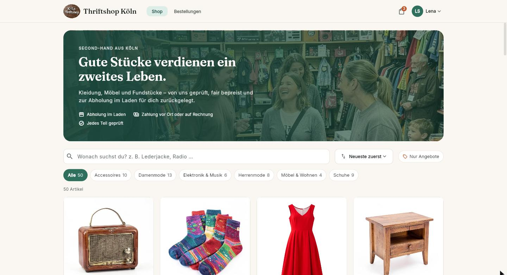
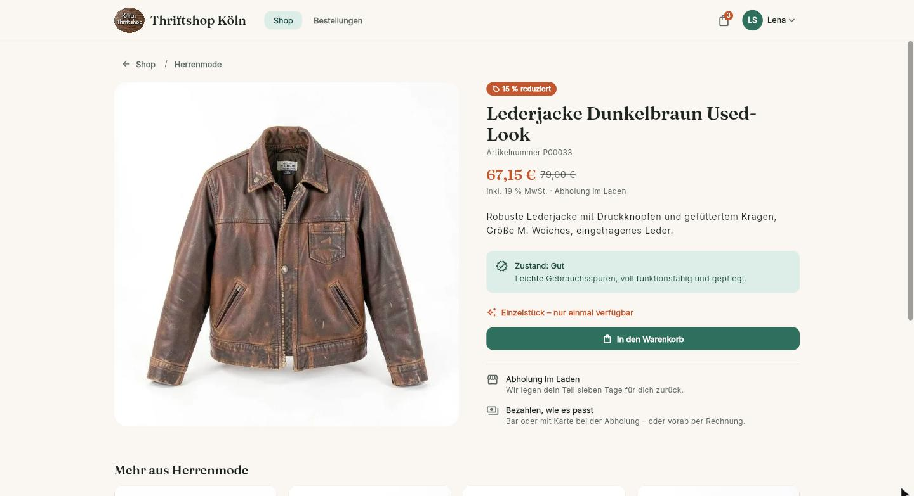
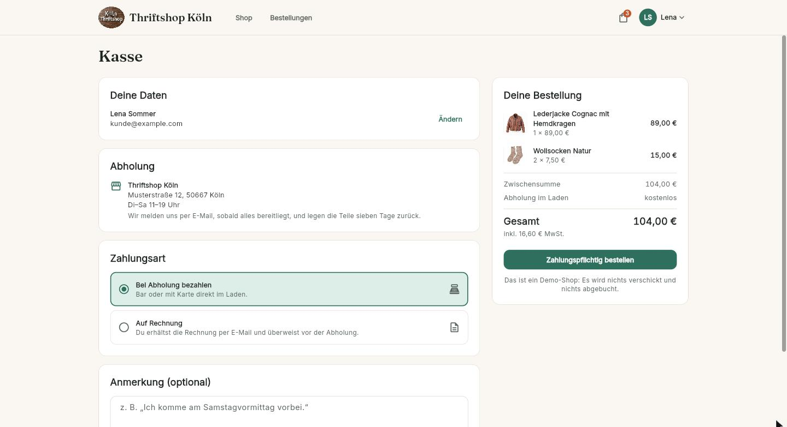
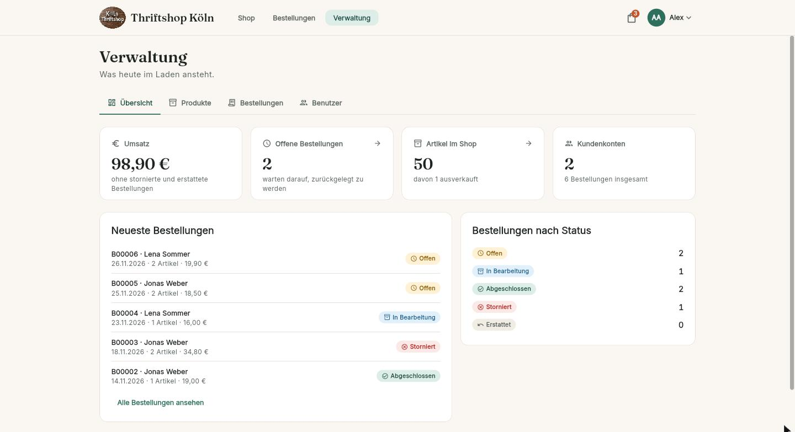
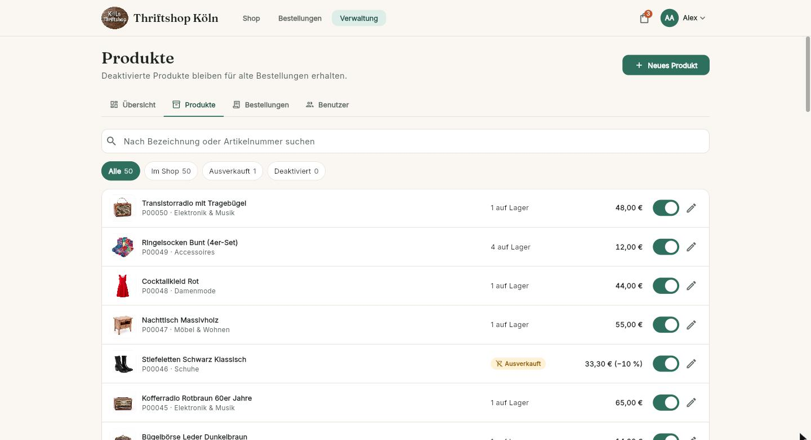
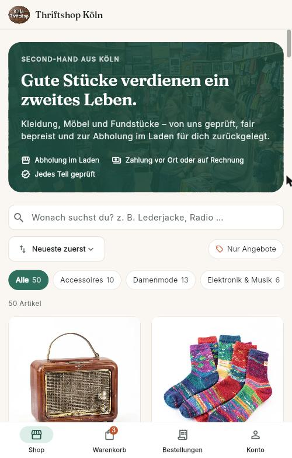

# Thriftshop Köln

A second-hand web shop with click-and-collect: customers browse the catalogue, order, and pick up
in store; staff manage products and orders in a built-in admin area.

**Flutter (web) frontend · Python FastAPI backend · SQLite** — everything runs on free, open-source
technology and starts with a single command.



> The shop's interface, the API field names and the code comments are in German — it is a shop
> for Cologne. This README is in English.

## Try it

Start the shop ([Quick start](#quick-start)) and sign in with one of the demo accounts. The login
page also has one-click buttons for them.

| Role          | E-mail              | Password    | Can do                                             |
|---------------|---------------------|-------------|----------------------------------------------------|
| Customer      | `kunde@example.com` | `kunde1234` | Order, see and cancel own orders, edit own account |
| Staff         | `team@example.com`  | `team1234`  | Everything above + manage products and orders      |
| Administrator | `admin@example.com` | `admin1234` | Everything above + assign roles                    |

The database is filled with 50 products, these accounts and a few sample orders on first start.

## Features

**Shop**
- Catalogue with live search, category filter, "on sale" filter and sorting
- Product pages with condition, availability and related items; readable URLs (`/produkt/lederjacke-…`)
- Cart that survives a page reload and reconciles itself with current prices and stock
- Checkout with pick-up in store and two payment options (pay on pick-up, invoice)
- Order history with status, and cancellation of open orders
- Account page: edit profile, change password, delete account
- Responsive: top navigation on desktop, bottom navigation on phones

**Admin area** (staff and administrators)
- Dashboard with key figures and the latest orders
- Products: create, edit, upload a photo, take out of the shop (soft delete)
- Orders: move an order through its lifecycle, cancel or refund it
- Users: assign roles (administrators only)

| Product page | Checkout |
|---|---|
|  |  |

| Admin dashboard | Product management |
|---|---|
|  |  |



## Quick start

### Option 1 — Docker (nothing else to install)

```bash
docker compose up --build
```

Open <http://localhost:8000>. The image builds the Flutter app and serves it together with the API.

### Option 2 — Local development

Requirements: [Python 3.12+](https://www.python.org/) and the [Flutter SDK](https://docs.flutter.dev/get-started/install) (3.41 or newer).

```bash
make install     # creates .venv, installs Python packages, runs flutter pub get
make backend     # terminal 1: API with auto-reload on http://localhost:8001
make frontend    # terminal 2: Flutter app in Chrome, talking to the API above
```

Without `make` (for example on Windows):

```bash
python -m venv .venv
.venv/bin/pip install -r backend/requirements-dev.txt     # Windows: .venv\Scripts\pip
cd backend && ../.venv/bin/uvicorn app.main:app --reload --port 8001

# second terminal
cd frontend && flutter pub get && flutter run -d chrome
```

No database server and no configuration are needed: the SQLite file is created at
`backend/data/thriftshop.db` on first start. Delete that file to reset the shop to the demo data.

### Option 3 — One process, like in production

```bash
make start       # builds the web app, then serves shop + API on http://localhost:8001
```

## How it is built

```
frontend/  Flutter app                        backend/  FastAPI app
└─ lib/                                       ├─ app/
   ├─ core/       config, theme, router,      │  ├─ api/       HTTP routes (thin)
   │              API client, formatting      │  ├─ services/  business rules: orders, prices
   ├─ models/     data classes (fromJson)     │  ├─ dao/       all SQL lives here
   ├─ services/   typed API calls             │  ├─ models/    domain dataclasses
   ├─ providers/  state (ChangeNotifier)      │  ├─ core/      config, database, security
   ├─ screens/    one folder per area         │  ├─ schemas.py request/response validation
   └─ widgets/    shared building blocks      │  └─ seed.py    demo data
                                              ├─ static/      product photos
                                              └─ tests/       pytest suite
```

- **Frontend:** Flutter with `provider` for state, `go_router` for URL routing and access guards,
  `dio` for HTTP. Widgets only render; state and API calls live in providers and services. One
  design system (`core/theme`, `core/constants`) defines every colour, spacing and text style.
- **Backend:** routes → services → DAOs. The DAOs use plain SQL through Python's built-in
  `sqlite3`, so the data access stays visible instead of hidden behind an ORM. Pydantic schemas
  validate every request and define exactly which fields leave the API.
- **One deployable unit:** in production FastAPI serves the built Flutter app, the API (`/api`)
  and the product photos (`/bilder`) from one origin — no CORS setup and nothing else to host.

Interactive API documentation is available at `/api/docs` while the backend is running.

### Rules the backend enforces

- **Prices are decided by the server.** An order contains only product IDs and quantities; price,
  discount and VAT rate are read from the database and stored with the order line, so later price
  changes never alter past orders.
- **Discounts** are percentages on the product or its category; the higher one applies. All prices
  include VAT, and the contained VAT is shown separately.
- **Stock is booked atomically.** Placing an order reduces stock in the same transaction and fails
  with a clear message if an item has just sold out. Cancelling or refunding puts items back —
  exactly once.
- **Order lifecycle:** `Offen → In Bearbeitung → Abgeschlossen`, with `Storniert` and `Erstattet`
  as exits. Customers can cancel only while an order is still `Offen`.
- **Access control:** passwords are hashed with bcrypt, sessions are JWTs, and every admin route
  checks the role stored in the database. A new account is always a customer; only an
  administrator can assign other roles.
- **Account deletion:** an account without orders is deleted; one with orders is anonymised so the
  order records stay consistent.

## Tests

```bash
make test
```

- **Backend:** 58 pytest tests run the real API against a temporary SQLite database — sign-up and
  login, role checks on every admin route, pricing, stock booking, order status transitions,
  image upload.
- **Frontend:** unit tests for the cart and the catalogue filter, plus static analysis.

Both run in GitHub Actions on every push (`.github/workflows/ci.yml`).

## Configuration

Everything works without configuration. These environment variables (or a `backend/.env` file)
change the defaults:

| Variable         | Default                      | Purpose                                                                 |
|------------------|------------------------------|-------------------------------------------------------------------------|
| `JWT_SECRET`     | random on every start        | Key for signing login tokens. Set it so logins survive a restart.       |
| `DATABASE_PATH`  | `backend/data/thriftshop.db` | Location of the SQLite file                                             |
| `UPLOAD_DIR`     | `uploads/` next to the database | Where uploaded product photos are stored                             |
| `CORS_ORIGINS`   | *(empty)*                    | Extra allowed browser origins, comma-separated (localhost is always allowed) |
| `SEED_DEMO_DATA` | `true`                       | Fill an empty database with the demo catalogue and accounts             |
| `DEMO_MODUS`     | `true`                       | Protect the demo accounts from password, e-mail and role changes        |

The frontend finds the API on its own (same origin in production, `localhost:8001` in
development). To point it elsewhere: `flutter build web --dart-define=API_URL=https://api.example.com`.

## Hosting it for free

The repository contains a `Dockerfile` and a `render.yaml` blueprint for
[Render](https://render.com)'s free plan: create a new *Blueprint* there, select this repository,
and Render builds and starts the container. Two things to know about a free plan:

- The service sleeps when idle, so the first visit after a pause takes up to a minute. The app
  shows a hint while it waits.
- The disk is not persistent, so the shop resets to the demo data on every restart — which suits
  a public demo.

Any host that runs a Docker container works the same way; the container listens on `$PORT`.

## Scope and known limits

- By design there is no online payment and no shipping: customers pay on pick-up or by invoice.
  No e-mails are sent; the confirmation page describes the next steps instead.
- The demo accounts have public passwords. `DEMO_MODUS` keeps them usable for every visitor, but
  anyone can sign in as administrator and edit products — set your own accounts and
  `DEMO_MODUS=false` for anything beyond a demo.
- The two typefaces (Inter, Fraunces) are loaded from Google Fonts at runtime. For a real German
  shop they should be bundled with the app instead.
- `docs/` holds the original planning documents of the project (in German: requirements, UML,
  wireframes, UI guideline). They describe the first design, which used MySQL; the application
  now uses SQLite and the structure described above.
