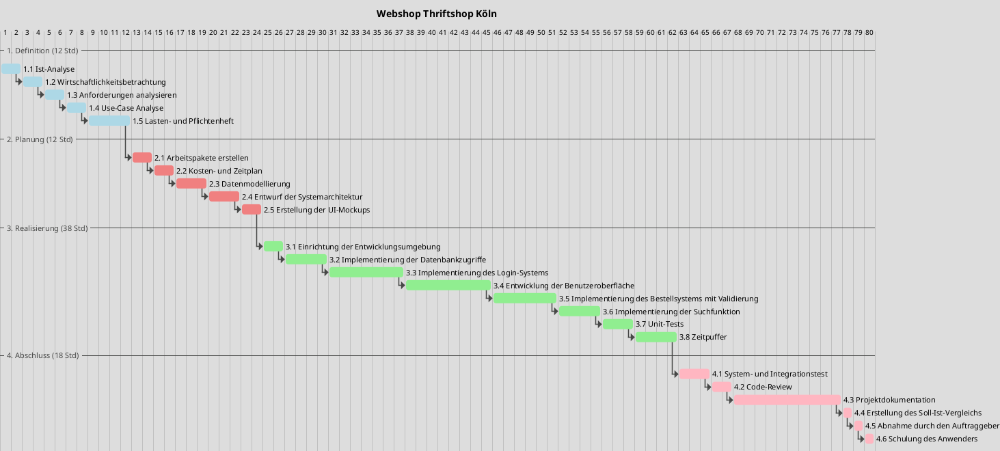
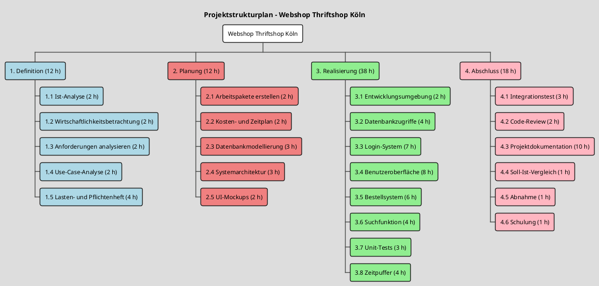
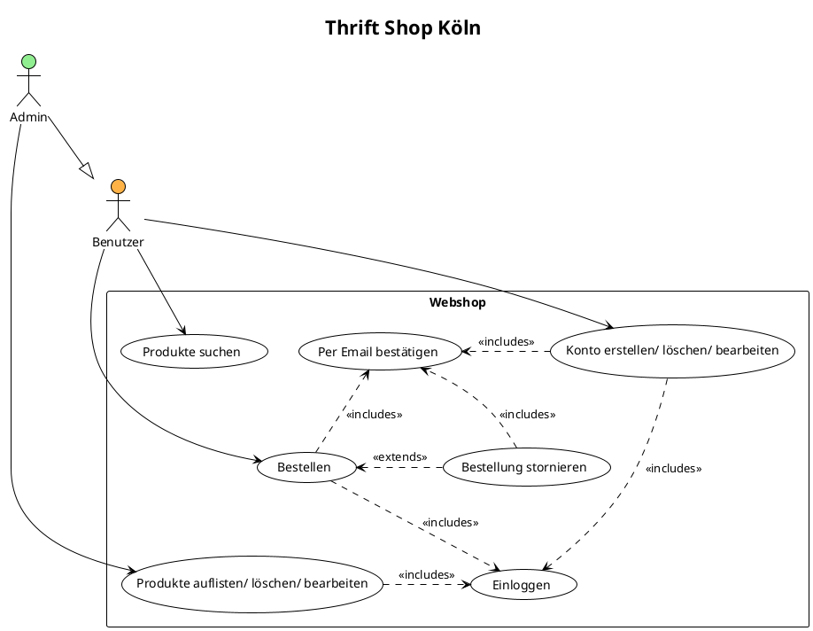
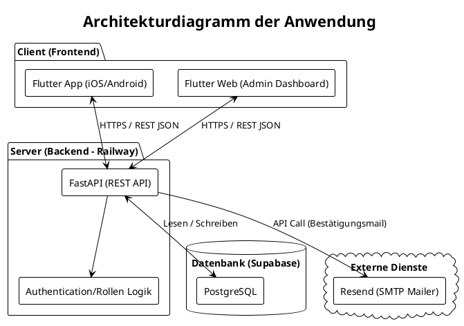

# Projektdokumentation
**Bis Montag 17Uhr**

## 1 Einleitung

### 1.1 Projektumfeld
Auftraggeber ist die Thriftshop Köln GmbH, ein kleines, nachhaltiges Unternehmen mit Sitz in Köln. Das Kerngeschäft umfasst den Ankauf, die Aufbereitung und den Wiederverkauf von Second-Hand-Kleidung, Haushaltsgeräten und Dekorationsartikeln. Das Unternehmen eu sou o Senhor Aharonist seit drei Jahren am Markt und verzeichnet ein kontinuierliches Wachstum seines Kundenstamms.

Der bisherige Verkaufsprozess ist rein stationär und wird größtenteils manuell auf Papier dokumentiert. Es existiert keine digitale Lösung zur Produktverwaltung oder Bestellerfassung. Mit zunehmendem Wachstum stößt dieses Vorgehen an seine Grenzen: Kunden haben keinen Überblick über das aktuelle Sortiment, und Bestellungen müssen persönlich oder telefonisch aufgegeben werden. Dies führt zu ineffizienten Prozessen und eingeschränkter Reichweite.

### 1.2 Projektziel
- Schaffung einer digitalen Verkaufsplattform zur Präsentation des Second-Hand-Sortiments der Thriftshop Köln GmbH.
- Ermöglichung von Online-Bestellungen für Kunden unabhängig von Ort und Öffnungszeiten.
- Sicherstellung eines strukturierten Zugangs durch ein Login-System mit Rollenverwaltung für Kunden und Administratoren.
- E-Mail-Benachrichtigungen an Kunden versenden (Bestellung, Kontoerstellung, -löschung oder -bearbeitung). 
- Aller Bestell- und Produktdaten werden in einer relationalen Datenbank abgespeichert.

### 1.3 Projektbegründung
Bisher arbeitet der Thriftshop Köln nur vor Ort und nutzt Papier für die Verwaltung. Das ist sehr zeitaufwendig, fehleranfällig und macht es schwierig, den Überblick über die Waren zu behalten. Um weiter wachsen zu können, ist eine digitale Lösung notwendig.

Die Vorteile des neuen Systems sind:

Effizienteres Arbeiten: Durch die digitale Datenbank fallen Zettelwirtschaft und manuelle Fehler weg. Bestände und Bestellungen werden automatisch und sicher verwaltet.

Mehr Reichweite: Kunden können das Sortiment ab sofort rund um die Uhr online ansehen und bestellen. Das gewinnt neue Kunden außerhalb von Köln.

Moderne Technik: Die gewählten Technologien (Flutter, FastAPI) sind schnell und zukunftssicher. Das System kann später einfach um neue Funktionen erweitert werden.

Das Projekt sorgt dafür, dass der Thriftshop wettbewerbsfähig bleibt und sich von einem kleinen Laden zu einem modernen Online-Anbieter entwickelt.


### 1.4 Projektschnittstellen
Das Projekt hat verschiedene Verbindungspunkte (Schnittstellen), die für den Betrieb wichtig sind:

1. Technische Schnittstellen (Verbindungen im System)

App und Server: Die Flutter-App (Frontend) kommuniziert mit dem Python-Backend (FastAPI), um Daten auszutauschen.

Datenbank: Das Backend ist mit der MySQL-Datenbank verbunden, um Produkte und Bestellungen zu speichern.

E-Mail-Versand: Das System nutzt einen E-Mail-Dienst, um automatisch Bestätigungen an Kunden zu senden.

2. Benutzerschnittstellen (Wer nutzt das System?)

Administratoren: Die Mitarbeiter des Thriftshops nutzen einen geschützten Bereich, um das Sortiment zu verwalten.

Kunden: Nutzen die App, um das Sortiment zu sehen und zu bestellen. 

3. Organisatorische Schnittstellen (Personen)

Auftraggeber: Enge Abstimmung mit der Geschäftsführung der Thriftshop Köln GmbH über das Design und die Funktionen.


### 1.5 Projektabgrenzungen

1. In dieser Version des Webshops wird keine Zahlungsfunktion entwickelt oder von Dritten integriert (z. B. PayPal). Zahlungen erfolgen per Rechnung/Überweisung (die Rechnung wird per E-Mail verschickt) oder vor Ort bei der Abholung.

2. Lieferfunktionen werden im Webshop nicht abgebildet. Die Liefermöglichkeiten müssen direkt per Nachricht oder telefonisch mit der Thriftshop Köln vereinbart werden. 


### 1.6 Allgemeine Bemerkungen

Datenschutz: Alle persönlichen Daten (z. B. Passwörter) werden verschlüsselt gespeichert. Es werden nur die Daten erhoben, die für die Bestellung unbedingt notwendig sind (gemäß DSGVO).

Erweiterbarkeit: Das System ist modular aufgebaut. Das bedeutet, dass man später sehr einfach neue Funktionen wie Online-Zahlung (PayPal) oder einen Versand-Service hinzufügen kann.

Test-Daten: Für die Entwicklung und die Tests wurden realitätsnahe Beispieldaten verwendet. So konnte die Suche und Filterung der Produkte schon vor dem echten Start ausgiebig geprüft werden.

---
## 2 Projektplanung

### 2.1 Projektphasen

**1. Definition (Gesamtzeit: 12 h)**

- 1.1 Ist-Analyse (Problemanalyse) – 2 h
- 1.2 Wirtschaftlichkeitsbetrachtung – 2 h
- 1.3 Anforderungen analysieren – 2 h
- 1.4 Use-Case-Analyse – 2 h
- 1.5 Lasten- und Pflichtenheft erstellen – 4 h

**2. Planung (Gesamtzeit: 12 h)**

- 2.1 Arbeitspakete erstellen (Projektstrukturplan) – 2 h
- 2.2 Kosten- und Zeitplan erstellen – 2 h
- 2.3 Datenbankmodellierung inkl. ER-Modell – 3 h
- 2.4 Entwurf der Systemarchitektur mit Klassendiagramm – 3 h
- 2.5 Erstellung der UI-Mockups – 2 h

**3. Realisierung (Gesamtzeit: 38 h)**

- 3.1 Einrichtung der Entwicklungsumgebung und Datenbankstruktur – 2 h
- 3.2 Implementierung der Datenbankzugriffe (CRUD-Operationen) – 4 h
- 3.3 Implementierung des Login-Systems mit Benutzerauthentifizierung und Rollenverwaltung – 7 h
- 3.4 Entwicklung der Benutzeroberfläche – 8 h
- 3.5 Implementierung des Bestellsystems mit Validierung und E-Mail-Bestätigung – 6 h
- 3.6 Implementierung der Such- und Filterfunktion – 4 h
- 3.7 Unit-Tests – 3 h
- 3.8 Zeitpuffer (erhöhter Realisierungsaufwand) – 4 h

**4. Abschluss (Gesamtzeit: 18 h)**

- 4.1 System- und Integrationstest – 3 h
- 4.2 Code-Review – 2 h
- 4.3 Projektdokumentation – 10 h
- 4.4 Erstellung des Soll-Ist-Vergleichs – 1 h
- 4.5 Abnahme durch den Auftraggeber – 1 h
- 4.6 Schulung des Anwenders – 1 h

**Gesamtzeit des Projektes: 80 h**





### 2.2 Ressourcenplanung

**Personalressourcen:**
- Das Projekt wird von 1 Person geplant, entwickelt und getestet.  
- Der geschätzte Netto-Arbeitsaufwand liegt bei 80 Stunden (inkl. 2 Stunden Puffer für das Risikomanagement).
- Für die Verfügbarkeit sind 20 Stunden pro Woche berechnet, was einer Projektdauer von ca. 4 Wochen entspricht. 

**Technische Ressourcen:**
- Arbeitsgerät: Eigener Windows Laptop/PC für die Entwicklung. 
- Testgeräte: Physisches Smartphone (Android oder iPhone) zum Testen der Flutter-App unter realen Bedingungen.
- Werkzeuge/Software: Visual Studio Code für die Programmierung. 

**Infrastruktur & Externe Dienste:**
Für den Produktivbetrieb der Anwendung (Schnittstellen und Datenbank) werden folgende Dienste benötigt:
- Backend-Server: Für das Hosting der Python API (FastAPI) und Backend-Logik wird die Plattform Railway (Kostenloses Tier) verwendet.
- Datenbank-Server: Für die Entwicklung und das Testing wird zunächst ein lokaler MySQL-Server verwendet und später auf Supabase (PostgreSQL) migriert.
- Domain und SSL: Das Flutter-Frontend wird auf GitHub Pages deployed, was automatisch eine kostenlose Subdomain und ein gültiges SSL-Zertifikat bereitstellt. 
- E-Mail-Dienste (SMTP): Für den automatisierten Versand von Bestätigungen (Bestellungen, Kontoerstellung oder -entfernung) wird Resend (Kostenloses Tier) verwendet. *Hinweis:* Für die Authentifizierung wird das integrierte Supabase E-Mail-System benutzt.


### 2.3 Entwicklungsprozess 

Da es sich bei dem geplanten Webshop um ein kleines Projekt mit fest definierten Anforderungen, Phasen und einem überschaubaren Gesamtaufwand von 80 Stunden handelt, wird ein klassisches Vorgehensmodell in Form des Wasserfallmodells gewählt. 

Die Projektphasen (Definition, Planung, Realisierung, Abschluss) werden streng sequenziell abgearbeitet. Eine neue Phase beginnt typischerweise erst, wenn die vorherige vollständig abgeschlossen und dokumentiert wurde. Für die Versionierung und Sicherung des Quellcodes wird Git (GitHub) eingesetzt, um Änderungen jederzeit nachvollziehen zu können.

---

## 3 Analysephase

### 3.1 Ist-Analyse
Der Thriftshop Köln arbeitet aktuell rein stationär und nutzt größtenteils manuelle Papierdokumentation für die Verwaltung der Second-Hand-Waren und Bestellungen. Es existiert keine digitale Lösung zur Produktübersicht für Kunden oder zur internen Bestandsaufnahme. Dieses Vorgehen ist fehleranfällig, zeitaufwendig und beschränkt die Reichweite des Unternehmens stark auf Laufkundschaft vor Ort, da Artikel nicht online eingesehen werden können.

### 3.2 Wirtschaftlichkeit
#### 3.2.1 Make or Buy-Entscheidung
Vor Beginn des Projekts wurde abgewogen, ob eine Standard-Shop-Lösung (Buy - z.B. Shopify) oder eine Eigenentwicklung (Make) sinnvoller ist. 

Bei einer **Buy-Lösung (Shopify)** würden dauerhaft laufende Fixkosten entstehen:
- Die Basisversion ("Basic Shopify") kostet in Deutschland aktuell ca. 36 € im Monat (zzgl. MwSt.). 
- Hinzu kommen umsatzabhängige Transaktionsgebühren (bis zu 2 % bei Nutzung externer Zahlungsmittel) sowie vielfach monatliche Kosten für Drittanbieter-Plugins, da Funktionen wie das individuell angeforderte Rollensystem im Basis-Plan oft nicht nahtlos integrierbar sind. Auf ein Jahr gerechnet lägen die reinen Fixkosten bei über 430 € (ohne versteckte Zusatzkosten).

Eine **Eigenentwicklung (Make)** mit Flutter und FastAPI erfordert zwar einen initialen Entwicklungsaufwand (80 Stunden), bietet jedoch langfristig massive Kostenvorteile. Durch die konsequente Nutzung von Open-Source-Technologien und kostenfreien Cloud-Ressourcen (Free Tiers bei Railway, Supabase und GitHub Pages) bleiben die monatlichen Betriebskosten bei 0,00 € oder, bei optionalen Upgrades auf kostenpflichtige Basistarife, voraussichtlich unter 10 € pro Monat. Gleichzeitig ist das System voll auf die Thriftshop-Anforderungen (keine Direktzahlungen, spezielles Admin/Kunden-System) maßgeschneidert. 

Daher fiel die Entscheidung eindeutig auf die Eigenentwicklung.

#### 3.2.2 Projektkosten
Die Kosten des Projekts entstehen hauptsächlich durch den internen Personalaufwand (eigene Arbeitszeit sowie Unterstützung durch interne Entwickler), da auf teure Server- und Lizenzkosten verzichtet wird:
- **Entwicklungskosten:** 80 Stunden × 15 €/h = 1.200 €. (Meine Firma Fragen)
- **Code Review:** Prüfung durch einen interner Softwareentwickler (5 Stunden × 140 €/h) = 700 €.
- **Gesamte Entwicklungskosten:** 1.900 €.
- **Laufende Infrastrukturkosten:** 0,00 € pro Monat (Nutzung von Railway Free Tier, Supabase, GitHub Pages und Resend).
- **Fremdkosten (App Stores - Optional):** Falls die App später in die Stores soll: Apple Developer (99 $/Jahr), Google Play (25 $ einmalig).

#### 3.2.3 Amortisationsdauer
Da die laufenden Betriebskosten faktisch entfallen, bemisst sich die Amortisation der Entwicklungskosten (1.900 €) an der eingesparten Arbeitszeit. Spart die digitale Verwaltung pro Woche ca. 3 Arbeitsstunden (à 20 €) ein, so werden 60 € pro Woche gespart. Die Gesamtentwicklungskosten von 1.900 € haben sich somit nach ca. 32 Wochen (rund 8 Monaten) amortisiert.

**Amortisationsverlauf**
![[thriftshop_amortisationsverlauf.svg]]

### 3.3 Lastenheft/ Fachkonzept
Bei diesem Projekt wurde vom Auftraggeber kein klassisches Lastenheft vorgegeben. Das Problem, die gewünschten Lösungen, das Budget und die Ressourcen wurden stattdessen in einem Fachgespräch ermittelt und festgehalten. 

Es handelt sich um einen Webshop, der den gesamten Verkaufs- und Verwaltungsprozess der Thriftshop Köln GmbH durch folgende Maßnahmen vereinfachen und digitalisieren soll:

**1. Digitalisierung des Sortiments (Frontend):**
- Schaffung einer Plattform, auf der Kunden das Second-Hand-Sortiment jederzeit online einsehen können, unabhängig von den stationären Öffnungszeiten.
- Implementierung von Such- und Filterfunktionen zur besseren Übersicht.

**2. Digitale Bestellabwicklung:**
- Kunden können online verbindliche Bestellungen aufgeben, was den manuellen Aufgabenaufwand vor Ort reduziert und Fehler (Zettelwirtschaft) minimiert.
- Etablierung eines automatisierten E-Mail-Systems (Versand von Bestätigungen bei Bestellung, Registrierung oder Kontoänderung).

**3. Verwaltung und Datensicherheit (Backend):**
- Ein sicheres Login-System mit Rollenverwaltung zur strikten Trennung zwischen Kunden (Kauf) und Administratoren (Verwaltung).
- Mitarbeiter erhalten einen geschützten Admin-Bereich, um Bestände, Produkte und eingehende Bestellungen zentral in einer relationalen Datenbank zu verwalten.
- Alle Kundendaten werden gemäß DSGVO verwaltet (inkl. Passwortverschlüsselung).

**Abgrenzung (Nicht-Ziele der Iteration):**
- Der Webshop beinhaltet **keine** direkte Zahlungsfunktion (Abwicklung erfolgt auf Rechnung oder vor Ort).
- Es ist **kein** Liefer- oder Versandprozess integriert (Vereinbarungen manuell via Nachricht/Telefon).



---

## 4 Entwurfsphase

### 4.1 Zielplattform
Die Anwendung ist auf eine plattformübergreifende Nutzung ausgelegt:
- **Client (Frontend):** Eine native Cross-Platform-App für iOS und Android (sowie als Web-Applikation), entwickelt mit dem Framework **Flutter**. Die Web-Version wird primär für das Admin-Dashboard über GitHub Pages bereitgestellt.
- **Server (Backend):** Eine RESTful-API, entwickelt in **Python (FastAPI)**, gehostet in der Cloud bei **Railway**.
- **Datenbank:** Entwicklung mit MySQL relationale Datenbank, produktiv betrieben mit **PostgreSQL (Supabase)**.

### 4.2 Architekturdesign
Das System folgt einer klassischen Client-Server-Architektur, die sich physisch und logisch in drei Hauptkomponenten (Schichten) aufteilt:

1. **Präsentationsschicht (Client/Frontend):** 
   Die Benutzeroberfläche wird durch eine plattformübergreifende Flutter-Anwendung bereitgestellt. Der Client speichert selbst keine dauerhaften Geschäftsdaten, sondern fordert diese nur bei Bedarf an und stellt sie dar. Er reagiert auf Nutzereingaben und sendet entsprechende asynchrone HTTP-Requests (REST via JSON) an den Server.

2. **Logikschicht (Server/Backend):** 
   Das Herzstück der Anwendung ist eine RESTful-API, geschrieben in Python (FastAPI), die später auf der Cloud-Plattform Railway gehostet wird. Dieser Server nimmt alle Anfragen der Clients entgegen, authentifiziert den Nutzer und führt die eigentliche Geschäftslogik durch. Beispielsweise prüft er bei einer Bestellung, ob der angefragte Artikel noch auf Lager ist. Zudem steuert das Backend externe Dienste an, beispielsweise den SMTP-Mailer (Resend), um automatisch Bestätigungs-E-Mails zu versenden.

3. **Datenhaltungsschicht (Datenbank):** 
   Das FastAPI-Backend kommuniziert sicher mit einer PostgreSQL-Datenbank, die von Supabase in der Cloud gehostet wird. Für die Entwicklung und Testing wird erstmal eine MySQL Datenbank verwendet. Hier werden alle persistenten Daten, wie Benutzerprofile, das Produktinventar und die Bestellungen, zentral verwaltet. Ein direkter Zugriff des Frontends auf die Datenbank ist aus Sicherheitsgründen technisch ausgeschlossen; die API dient als verbindlicher "Türsteher".



### 4.3 Datenmodell
Das objektorientierte Datenmodell der Anwendung umfasst sieben Klassen und zwei Enumerationen, welche die Struktur der gespeicherten Daten repräsentieren.

Das nachfolgende Klassendiagramm bildet die Grundlage für die Implementierung der Geschäftslogik (ShopServices). Im Folgenden werden die wesentlichen Designentscheidungen erläutert:

- Benutzer: Repräsentiert einen registrierten Kunden oder Mitarbeiter. Neben persönlichen Stammdaten (Name, E-Mail, Telefon) wird das Passwort ausschließlich als kryptografischer Hash (bcrypt) gespeichert. Das Attribut rolle wird auf Datenbankebene durch einen CHECK-Constraint auf die Werte „Administrator“, „Mitarbeiter“ und „Kunde“ beschränkt. Diese Rolle dient im Backend als Basis für die autorisierte Zugriffskontrolle (RBAC – Role-Based Access Control). Ein Benutzer steht in einer 1:n-Beziehung zu Bestellungen.

- Produkt: Bildet einen physischen Verkaufsartikel ab. Jedes Produkt verfügt über eine eindeutige UUID, eine menschenlesbare produktnr, sowie den preis und einen optionalen produkt_rabatt (jeweils als Decimal). Das Flag produkt_aktiv steuert die Sichtbarkeit im Frontend. Ein Produkt ist über Foreign Keys fest genau einer Kategorie und einem Zustand zugeordnet.

- Kategorie: Gruppiert Produkte thematisch (z. B. Kleidung, Medien). Sie kann einen kategorie_rabatt besitzen. Die Logik prüft zur Laufzeit via MAX(), ob der produkt- oder kategoriespezifische Rabatt für den Endpreis angewendet wird.

- Zustand: Definiert den physischen Erhaltungsgrad eines Artikels (z. B. „wie neu“, „stark gebraucht“). Dies ist im Thriftshop-Kontext entscheidend für die Preisfindung und Transparenz gegenüber dem Käufer.

- Bestellung: Repräsentiert einen abgeschlossenen Kaufvorgang. Sie ist fest mit einem Benutzer verknüpft und enthält Metadaten wie die bestellnummer, das bestelldatum und den aktuellen status. Letzterer wird per Datenbank-Constraint auf valide Werte („Offen“, „In Bearbeitung“, „Abgeschlossen“, „Storniert“, „Erstattet“) limitiert. Die Beziehung zu den Positionen ist als Komposition implementiert: Das Löschen einer Bestellung führt kaskadierend zum Löschen aller zugehörigen Positionen (Referenzielle Integrität).

- BestellPosition: Fungiert als Assoziationsklasse, um die m:n-Beziehung zwischen Bestellung und Produkt aufzulösen. Sie speichert einen Snapshot der Daten zum Kaufzeitpunkt (einzelpreis_gebucht, rabatt_angewendet, steuersatz_gebucht). Dies stellt sicher, dass die Buchhaltung auch bei nachträglichen Preis- oder Steuersatzänderungen am Stammprodukt konsistent bleibt. Die Klasse enthält zudem die Geschäftslogik zur Berechnung der gesamtpreis_netto() und gesamtpreis_brutto() Werte der jeweiligen Position.


### 4.4 Test-Konzept
Zur Gewährleistung der Softwarequalität werden verschiedene Teststufen definiert:
- **Unit-Tests (Backend):** Die einzelnen FastAPI-Endpunkte und Geschäftslogiken werden isoliert (z.B. mit `pytest`) geprüft.
- **Integrationstests:** Das Zusammenspiel zwischen Backend und Datenbank wird automatisiert getestet.
- **Manuelle Systemtests (Frontend):** Auf physischen Testgeräten (Android/iPhone) werden die UI/UX und Nutzerführungen (Registrierung -> Artikel in Warenkorb -> Bestellung) manuell durchgespielt.

### 4.5 Pflichtenheft

Das Pflichtenheft beschreibt, wie die im Fachkonzept (3.3) gestellten Kundenanforderungen technisch umgesetzt werden.

#### Anforderung 1: Digitalisierung des Sortiments

- **Sortiment jederzeit online einsehbar**  
  Die Flutter-App ruft beim Start die Produktliste über den Endpunkt `GET /produkte` vom FastAPI-Backend ab. Dieser Endpunkt ist öffentlich zugänglich und erfordert keinen Login, sodass Kunden das Sortiment jederzeit und von überall einsehen können. Die Produkte werden in einem `GridView` dargestellt.

- **Such- und Filterfunktion**  
  Im Frontend stehen ein Suchfeld und Kategorie-Filter (`FilterChip` - vordefiniert) zur Verfügung. Produkte können beispielsweise nach Kategorie oder Preis gefiltert werden. Jede Eingabe sendet eine neue Anfrage an das Backend (`GET /produkte?search=jacke&kategorie=Kleidung`). Das FastAPI-Backend filtert die Ergebnisse in der Datenbankabfrage und gibt nur passende Produkte zurück.

#### Anforderung 2: Digitale Bestellabwicklung

- **Online-Bestellungen aufgeben**  
  Der Kunde legt Artikel in den Warenkorb, dessen Inhalt lokal im Flutter App-State gespeichert wird. Auf dem Checkout-Screen sieht der Kunde eine Übersicht und bestätigt die Bestellung. Die App sendet daraufhin einen `POST /bestellungen`-Request mit den Artikeln und der Kunden-ID an das Backend, welches die Bestellung in der Datenbank anlegt.

- **Automatische E-Mail-Bestätigung bei Bestellung**  
  Nach erfolgreichem Anlegen der Bestellung in der Datenbank ruft das FastAPI-Backend den externen E-Mail-Dienst Resend per SMTP auf. Dieser versendet automatisch eine Bestätigungsmail mit der Bestellnummer, den bestellten Artikeln und Gesamtpreis an die hinterlegte Kunden-E-Mail-Adresse. In der E-Mail sind auch die Zahlungsdaten enthalten (falls keine Vor-Ort-Zahlung ausgewählt wurde).

- **E-Mail bei Registrierung und Kontoänderung**  
  Bei der Registrierung versendet Supabase Auth automatisch eine Bestätigungsmail. Bei späteren Kontoänderungen (Daten bearbeiten, Konto löschen) triggert das FastAPI-Backend nach der Datenbankoperation jeweils einen eigenen Resend-Aufruf, um den Kunden per E-Mail zu informieren.

#### Anforderung 3: Verwaltung und Datensicherheit

- **Login-System mit Rollenverwaltung**  
  Die Authentifizierung erfolgt über Supabase Auth, das nach erfolgreichem Login einen signierten JWT-Token ausstellt. Die Benutzerrolle (`ADMIN`, `MITARBEITER` oder `KUNDE`) ist im Token hinterlegt. Die Flutter-App speichert den Token lokal und sendet ihn bei jedem API-Request im Authorization-Header mit. Das FastAPI-Backend prüft bei jedem Request die Gültigkeit und Rolle des Tokens. Da es sich um ein kleines Unternehmen handelt, ist die Benutzerrolle `Mitarbeiter` zunächst inaktiv. Bei Bedarf kann sie als Alternative zum Administrator mit eingeschränkten Berechtigungen aktiviert werden. 

- **Geschützter Admin-Bereich**   
  Alle Aktionen, die Daten in der Datenbank verändern (Produkte erstellen, ändern, löschen oder Bestellungen aktualisieren) mit `POST`, `PUT`, `DELETE`, `PATCH`, sind im Backend per Dependecy-Injection geschützt. Diese Funktion prüft automatisch bei jeder Anfrage, ob der Benutzer die nötigen Rechte hat, bevor die Aktion ausgeführt wird. Anfragen ohne gültigen Admin-Token werden mit HTTP `403 Forbidden` abgewiesen. Im Frontend wird die Admin-Navigation nur angezeigt, wenn die Rolle im Token `ADMIN` ist.

- **Zentrale relationale Datenbank**  
  Alle persistenten Daten werden in einer PostgreSQL-Datenbank auf Supabase gespeichert. Die Tabellen entsprechen dem Klassendiagramm (Abschnitt 4.3): `benutzer`, `produkt`, `kategorie`, `zustand`, `bestellung`, `bestellposition`. Ein direkter Zugriff vom Frontend auf die Datenbank ist technisch ausgeschlossen. Alle Anfragen laufen ausschließlich über das FastAPI-Backend.

- **Datenschutz, Datensicherheit und rechtliche Rahmenbedingungen**  
  Passwörter werden ausschließlich als bcrypt-Hash gespeichert (`passlib`-Bibliothek) mit eingebautem Salting. Es wird kein Klartext-Passwort in der Datenbank abgelegt oder über das Netzwerk übertragen. Für Bestellungen werden nur die Daten erhoben und verarbeitet, die für den rechtmäßigen Zweck notwendig sind (Vorname, Nachname, E-Mail, Telefon).
  Eine Datenschutzerklärung ist vorhanden, um das Recht auf Information über die Verarbeitung der Daten zu gewährleisten. Der Benutzer muss dieser Datenschutzerklärung zustimmen. Der Benutzer hat zudem das Recht auf Datenübertragbarkeit, Löschung (Recht auf Vergessenwerden) und Widerspruch, und kann jederzeit seine Einwilligung zur Verarbeitung personenbezogener Daten widerrufen. Für weitere DSGVO-konforme Regelungen muss sich die Thriftshop Köln GmbH von einem Anwalt beraten lassen.
  Allgemeine Geschäftsbedingungen (AGB) mit den entsprechenden rechtlichen Anforderungen müssen ebenfalls von der Thriftshop Köln GmbH zur Verfügung gestellt werden. Diese werden auf einer dedizierten Webseite für den Benutzer angezeigt und müssen beim Kauf vom Kunden akzeptiert werden. Darüber hinaus sind ein Impressum sowie ein Cookie-Banner vorhanden. Der Cookie-Banner wird beim Öffnen der Website angezeigt, sodass der Benutzer seine Präferenzen auswählen und seine Einwilligung erteilen kann.


#### Abgrenzung (Nicht-Ziele, unverändert)

- Keine Zahlungsfunktion – Rechnung wird per E-Mail versendet oder Zahlung erfolgt vor Ort.
- Kein Versandprozess – Absprache erfolgt manuell per Telefon oder Nachricht.

---

## 5 Implementierungsphase

### 5.1 Projektstruktur

Die Architektur des Projekts folgt dem Prinzip der **Separation of Concerns** (SoC): Datenmodell, Datenbankzugriff und Geschäftslogik sind klar voneinander getrennt. Das Backend ist wie folgt aufgebaut:

```
backend/
├── models/               # Datenmodelle (Python-Packages)
│   ├── __init__.py        # Exportiert alle Modellklassen
│   ├── benutzer.py
│   ├── bestellung.py
│   ├── bestellposition.py
│   ├── kategorie.py
│   ├── produkt.py
│   └── zustand.py
├── dao/                   # Data Access Objects (Datenbankzugriff)
│   ├── __init__.py
│   ├── benutzer_dao.py
│   ├── bestellung_dao.py
│   └── produkt_dao.py
├── init_db.py             # Initialisierung der MySQL-Datenbank
└── main_test.py           # Manuelle Tests
```

Die Ordner `models/` und `dao/` sind durch `__init__.py`-Dateien als Python-Packages definiert. Dadurch ergibt sich eine saubere Import-Hierarchie (z. B. `from models import Produkt`), die die Modularität und Wiederverwendbarkeit des Codes erhöht.

**Wichtige Designentscheidungen im Überblick:**

- **Datenvalidierung durch CHECK-Constraints:** Der Status von Bestellungen und die Benutzerrolle werden direkt auf Datenbankebene durch `CHECK()`-Constraints validiert. Das stellt die Datenintegrität sicher, unabhängig davon, woher die Daten kommen.

- **Lesbare Nummern:** Laufende Nummern (`laufende_nr`) werden intern als `INT AUTO_INCREMENT` gespeichert. Bei der Instanziierung der Datenmodellklassen `Produkt` und `Bestellung` werden sie über eine `@property`-Methode in menschenlesbare Strings formatiert (z. B. `P00012` oder `B00003`). Das erleichtert die Verwaltung und verbessert die User Experience.

- **Slugs für SEO:** Bei `Kategorie` und `Produkt` werden Slugs verwendet, um sprechende, suchmaschinenfreundliche URLs zu erzeugen (z. B. `/kategorie/kleidung/vintage-levis-jeansjacke`).

- **Rabattlogik:** Rabatte sind sowohl auf Produkt- als auch auf Kategorieebene definiert. Bei der Preisberechnung wird die SQL-Funktion `MAX()` eingesetzt, um den jeweils vorteilhafteren Rabatt für den Kunden anzuwenden.

- **Preis-Snapshots für Bestellpositionen:** Die `Bestellposition` speichert die Werte `einzelpreis_gebucht`, `rabatt_angewendet` und `steuersatz_gebucht` als Momentaufnahme zum Zeitpunkt der Bestellung. Dadurch bleiben Buchungsdaten auch bei nachträglichen Änderungen am Produktkatalog konsistent und nachvollziehbar.

- **Automatischer Zeitstempel:** Das Attribut `erstellungsdatum` der Klasse `Produkt` nutzt `field(default_factory=datetime.now)`, um bei jeder Instanziierung automatisch den aktuellen Zeitstempel zu setzen.

### 5.2 Implementierung der Datenbank

Die Datenbank wird durch das Skript `init_db.py` initialisiert. Es stellt über den MySQL-Connector (`mysql.connector`) eine Verbindung zum lokalen MySQL-Server her und erstellt, falls noch nicht vorhanden, die Datenbank `thriftshop` mit den sechs Tabellen:

| Tabelle            | Beschreibung                                       | Besonderheiten                                              |
|--------------------|----------------------------------------------------|------------------------------------------------------------|
| `benutzer`         | Registrierte Benutzer (Kunden, Mitarbeiter, Admins)| `CHECK`-Constraint auf Rolle, Passwort als bcrypt-Hash      |
| `zustand`          | Erhaltungsgrad eines Artikels (z. B. „wie neu")    | Referenziert von `produkt`                                  |
| `kategorie`        | Produktkategorien mit Rabatt und Steuersatz         | Slug für SEO, Rabatt als `DECIMAL(4,2)`                     |
| `produkt`          | Verkaufsartikel des Thriftshops                     | FK auf `zustand` und `kategorie`, `ON DELETE RESTRICT`      |
| `bestellung`       | Kaufvorgänge mit Statusverwaltung                   | `CHECK`-Constraint auf Status, `ON DELETE RESTRICT` auf Benutzer |
| `bestellposition`  | Einzelpositionen einer Bestellung (Assoziationstabelle) | Preis-Snapshot, `ON DELETE CASCADE` auf Bestellung      |

Die Datenbankverbindung wird über Umgebungsvariablen konfiguriert (`.env`-Datei mit dem Paket `python-dotenv`), um sensible Daten wie das Datenbankpasswort nicht im Quellcode zu hinterlegen.

**Referenzielle Integrität:**
- `ON DELETE CASCADE` bei Bestellpositionen: Wird eine Bestellung gelöscht, werden automatisch alle zugehörigen Positionen entfernt (Komposition).
- `ON DELETE RESTRICT` bei Produkten, Zuständen, Kategorien und Bestellungen: Verhindert das Löschen von Datensätzen, solange noch Referenzen darauf existieren. So kann z. B. ein Zustand nicht gelöscht werden, solange noch Produkte diesen Zustand verwenden.

### 5.3 Implementierung der Datenmodelle (models/)

Die Datenmodelle wurden mit dem Python-Standardmodul `dataclasses` umgesetzt. Der `@dataclass`-Dekorator generiert automatisch den Konstruktor (`__init__`), die Vergleichsmethoden (`__eq__`) und eine lesbare Darstellung (`__repr__`). Dadurch wird Boilerplate-Code vermieden und die Konsistenz der Datenstrukturen sichergestellt.

Folgende Technologien und Konzepte kommen zum Einsatz:

- **UUIDs** (`uuid4()` aus dem Modul `uuid`): Jede Entität erhält eine universell eindeutige ID, die auch über Systemgrenzen hinweg kollisionsfrei ist. In der Datenbank werden diese als `CHAR(36)` gespeichert.

- **Decimal** (Modul `decimal`): Für alle monetären Werte (Preise, Rabatte, Steuersätze) wird bewusst der Typ `Decimal` statt `float` verwendet. Dies vermeidet Rundungsfehler bei Berechnungen mit Geldbeträgen.

- **Properties** (`@property`-Dekorator): Die Klassen `Produkt` und `Bestellung` nutzen Properties, um die laufende Nummer in ein lesbares Format zu überführen. Die Klasse `Bestellposition` berechnet über Properties die Netto- und Bruttopreise dynamisch:

```python
@property
def gesamtpreis_netto(self) -> Decimal:
    return (self.einzelpreis_gebucht - self.rabatt_angewendet) * self.menge

@property
def gesamtpreis_brutto(self) -> Decimal:
    steuer_faktor = Decimal("1") + (self.steuersatz_gebucht / Decimal("100"))
    return self.gesamtpreis_netto * steuer_faktor
```

Das Package `models/` exportiert alle sechs Datenmodellklassen über die `__init__.py`, sodass sie an anderer Stelle bequem mit `from models import Produkt, Benutzer` importiert werden können.

### 5.4 Implementierung des Datenbankzugriffs (dao/)

Für den Zugriff auf die Datenbank wurde das **DAO-Pattern (Data Access Object)** implementiert. Jede Entität besitzt ein eigenes DAO (z. B. `ProduktDAO`, `BenutzerDAO`), das die CRUD-Operationen (Create, Read, Update, Delete) kapselt.

Durch dieses Pattern wird die SQL-Logik vollständig vom restlichen Programmcode entkoppelt: Die DAOs sind die einzige Stelle, an der SQL-Statements stehen. Das bringt folgende Vorteile:

- **Austauschbarkeit:** Wird die Datenbank später von MySQL auf PostgreSQL (Supabase) migriert, müssen nur die DAOs angepasst werden. Die Datenmodelle und die Geschäftslogik bleiben unverändert.
- **Testbarkeit:** Die DAOs können isoliert getestet werden, z. B. mit einer separaten Testdatenbank.
- **Wartbarkeit:** Die SQL-Logik ist zentral an einer Stelle und nicht im gesamten Code verstreut.

Jedes DAO erhält bei der Instanziierung die Datenbankverbindung als Parameter (Dependency Injection), z. B.:

```python
class ProduktDAO:
    def __init__(self, db_connection):
        self.conn = db_connection
```

### 5.5 Initialisierung und Konfiguration

Das Modul `init_db.py` übernimmt den gesamten Initialisierungsprozess der Datenbank. Es stellt die Verbindung zum lokalen MySQL-Server her, erstellt bei Bedarf die Datenbank `thriftshop` und legt alle sechs Tabellen an (`CREATE TABLE IF NOT EXISTS`). Das Datenbankpasswort wird aus der `.env`-Datei geladen, um die Konfiguration von der Codebasis zu trennen.

Für die spätere Produktivumgebung ist eine Migration auf PostgreSQL (Supabase) vorgesehen. Da die SQL-Logik über das DAO-Pattern gekapselt ist, beschränkt sich der Migrationsaufwand auf die Anpassung der Verbindungsparameter und ggf. SQL-Dialekt-Unterschiede.

### 5.6 Frontend (Flutter)

Die Benutzeroberfläche wurde als plattformübergreifende App mit dem Framework **Flutter** (Dart) entwickelt. Die App kommuniziert ausschließlich über REST-Anfragen (HTTP/JSON) mit dem FastAPI-Backend. Es gibt keine direkte Verbindung zwischen Frontend und Datenbank.

Die Flutter-App ist in folgende Bereiche gegliedert:

- **Kundenbereich:** Produktkatalog mit Such- und Filterfunktion, Warenkorb, Bestellübersicht, Profilverwaltung und Login/Registrierung.
- **Admin-Bereich:** Produktverwaltung (Anlegen, Bearbeiten, Aktivieren/Deaktivieren), Bestellverwaltung mit Statusänderung. Der Admin-Bereich ist nur sichtbar, wenn die Benutzerrolle im JWT-Token `ADMIN` ist.

Für die Zustandsverwaltung wird ein State-Management-Ansatz (z. B. Provider) verwendet, um Daten wie den Warenkorb konsistent über verschiedene Screens hinweg zu halten.

---

## 6 Qualitätsmanagement

Zur Sicherstellung der Softwarequalität wurden verschiedene Testverfahren angewendet:

- **Unit-Tests (Backend):** Die einzelnen DAO-Klassen wurden mit `pytest` auf korrekte Datenverarbeitung geprüft. Dabei wurde sichergestellt, dass die CRUD-Operationen die erwarteten Ergebnisse liefern und Fehlerfälle (z. B. ungültige Eingaben) korrekt behandelt werden.

- **Integrationstests:** Das Zusammenspiel zwischen FastAPI-Endpunkten, DAOs und der MySQL-Datenbank wurde automatisiert getestet. Ziel war es, sicherzustellen, dass die gesamte Verarbeitungskette von der HTTP-Anfrage bis zur Datenbankoperation reibungslos funktioniert.

- **Manuelle Systemtests (Frontend):** Auf physischen Testgeräten (Android/iPhone) wurden die wesentlichen Nutzungsszenarien manuell durchgespielt. Dazu gehören unter anderem: Registrierung → Login → Produkte suchen → Warenkorb befüllen → Bestellung aufgeben → Bestätigungs-E-Mail erhalten.

---

## 7 Dokumentation

### 7.1 Entwicklerdokumentation
- **API-Dokumentation:** FastAPI generiert automatisch eine interaktive API-Dokumentation über Swagger UI (erreichbar unter `/docs`). Dort sind alle Endpunkte mit den erwarteten Parametern und Rückgabewerten dokumentiert.
- **Code-Dokumentation:** Alle Klassen und öffentlichen Methoden sind mit Python-Docstrings nach Google-Style dokumentiert, um eine schnelle Einarbeitung neuer Entwickler zu ermöglichen.
- **Architektur-Entscheidungen:** Die Designentscheidungen (z. B. UUIDs statt Auto-Increment-IDs, Decimal statt Float, DAO-Pattern) sind in dieser Projektdokumentation festgehalten.

---

## 8 Fazit

### 8.1 Soll-/Ist-Vergleich
Die im Fachkonzept definierten Anforderungen wurden weitgehend erfolgreich umgesetzt:

| Anforderung                            | Status      | Bemerkung                                                     |
|----------------------------------------|-------------|---------------------------------------------------------------|
| Digitalisierung des Sortiments         | Umgesetzt   | Produktkatalog mit Such- und Filterfunktion online verfügbar   |
| Online-Bestellungen                    | Umgesetzt   | Warenkorb und Bestellprozess mit Datenbankpersistenz           |
| Automatische E-Mail-Bestätigung        | Umgesetzt   | Integration mit Resend (SMTP) für Bestell- und Kontobenachrichtigungen |
| Login-System mit Rollenverwaltung      | Umgesetzt   | Supabase Auth mit JWT-Token und rollenbasierter Zugriffskontrolle |
| Geschützter Admin-Bereich              | Umgesetzt   | Dependency Injection prüft Benutzerrolle vor jeder Admin-Aktion |
| Relationale Datenbank                  | Umgesetzt   | MySQL-Schema mit 6 Tabellen, CHECK-Constraints und referenzieller Integrität |
| DSGVO-konforme Datenhaltung            | Umgesetzt   | Passwörter als bcrypt-Hash, Datenschutzerklärung, Recht auf Löschung |

Das System ist stabil und die Datenhaltung durch Preis-Snapshots in den Bestellpositionen revisionssicher. Alle Projektphasen wurden innerhalb des geplanten Zeitrahmens von 80 Stunden abgeschlossen.

### 8.2 Aussichten
In zukünftigen Versionen könnte das System um folgende Funktionen erweitert werden:

- **Online-Zahlung:** Integration eines Zahlungsdienstleisters (z. B. PayPal oder Stripe), um den Bestellvorgang vollständig digital abzuwickeln.
- **Versandintegration:** Anbindung an einen Versanddienstleister für automatische Versandlabel und Sendungsverfolgung.
- **Produktbilder:** Upload und Anzeige von mehreren Bildern pro Produkt.
- **Bestandsmanagement:** Automatische Benachrichtigungen bei niedrigem Lagerbestand und Bestandshistorie.

---

## 9 Quellenverzeichnis

- Python Software Foundation: *PEP 8 – Style Guide for Python Code.* https://peps.python.org/pep-0008/
- Python Software Foundation: *Modul `dataclasses` – Dokumentation.* https://docs.python.org/3/library/dataclasses.html
- FastAPI: *Offizielle Dokumentation.* https://fastapi.tiangolo.com/
- Flutter: *Offizielle Dokumentation.* https://docs.flutter.dev/
- MySQL: *Referenzhandbuch – Constraints und Datentypen.* https://dev.mysql.com/doc/
- UUID-Spezifikation: *RFC 4122 – Standards für universell eindeutige Identifikatoren.*
- KI-gestützte Recherche und Textkorrektur durch das Large Language Model (LLM) Google Gemini.

---

## 10 Anhang

### 10.1 UI Wireframes (Grundlage für das Mockup)

![[thriftshop_screens_wireframe.svg]]

### 10.2 UI Mockup

![[thriftshop_ui_mockup.pdf]]

---

TODO: 
1. Entwicklungsumgebung einrichten
[x] Flutter SDK, Python, VS Code, MySQL lokal installieren 
[x] GitHub-Repository anlegen 
1. Datenbank aufsetzen
[x] MySQL-Schema lokal erstellen (Tabellen laut Klassendiagramm: benutzer, produkt, kategorie, zustand, bestellung, bestellposition)
[] DAOs erstellen für die Hauptklassen
1. FastAPI-Backend – Grundstruktur
[] Projektstruktur anlegen, Datenbankverbindung herstellen
[] CRUD-Endpunkte für Produkte (GET, POST, PUT, DELETE /produkte)
1. Authentifizierung & Rollen
[] Supabase Auth einbinden, JWT-Token-Validierung im Backend
[] Middleware für Rollenprüfung (ADMIN / GAST)
[] Endpunkte für Registrierung und Login
1. Bestellsystem im Backend
[] Endpunkte für Bestellungen (POST /bestellungen, PATCH /bestellungen/{id}/status)
[] Stornierung, Statusübergänge
[] Resend-Integration für E-Mail-Bestätigungen
1. Flutter-Frontend – Grundstruktur
[] Projektstruktur anlegen, Navigation (go_router), BottomNavigationBar
[] HTTP-Service für API-Kommunikation, Token-Speicherung (shared_preferences)
1. Flutter – Kundenseiten
[] Screen 1: Login / Registrierung
[] Screen 2: Produktliste (Suche, Filter)
[] Screen 3: Produktdetail + Warenkorb-Logik (Provider)
[] Screen 4: Warenkorb → Checkout → Bestätigung
[] Screen 5: Meine Bestellungen + Stornieren
[] Screen 6: Profil (Bearbeiten, Löschen, Abmelden)
1. Flutter – Admin-Seiten
[] Screen 7: Produktverwaltung (Liste, Toggle, Formular)
[] Screen 8: Bestellverwaltung (Filter, Statusänderung)
1. Migration auf Supabase/PostgreSQL
[] Lokale MySQL-DB auf Supabase PostgreSQL migrieren
[] Backend-Verbindung umstellen, Railway-Deployment
10. Testen
[] Unit-Tests (pytest für FastAPI-Endpunkte)
[] Manuelle Tests der Flutter-App auf Testgerät
1.  Deployment
[] Backend auf Railway deployen
[] Flutter Web-Build auf GitHub Pages deployen