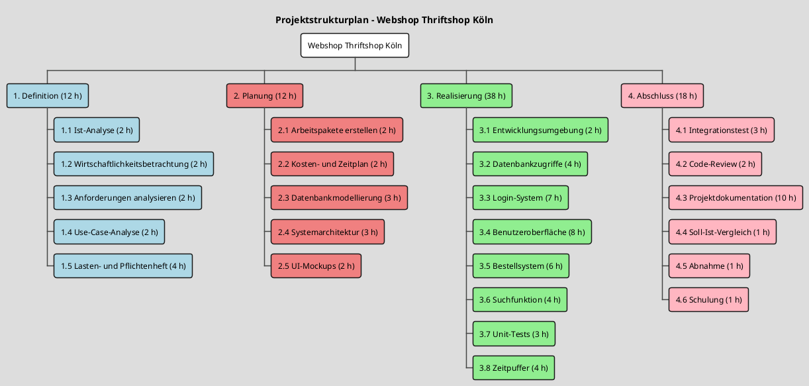
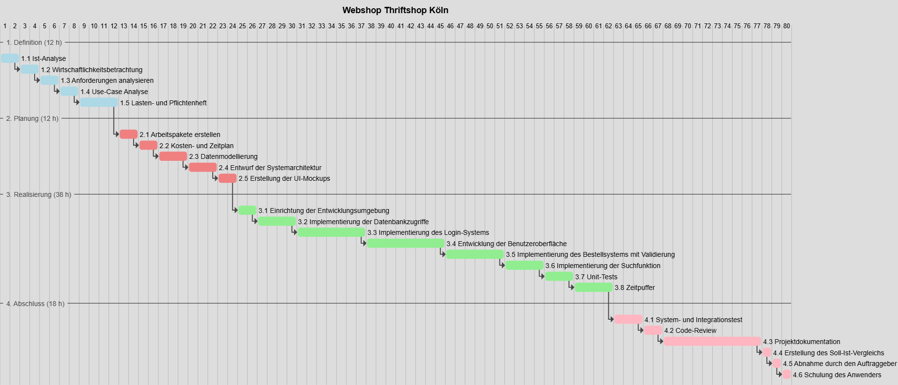
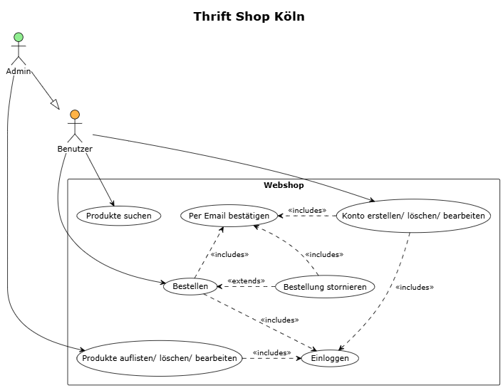
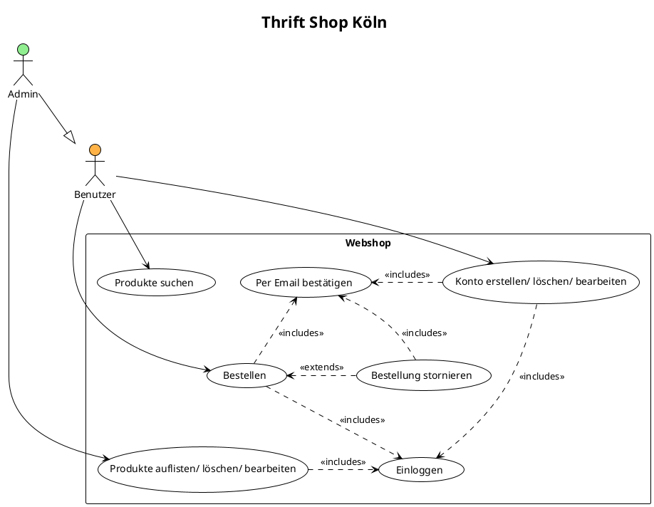
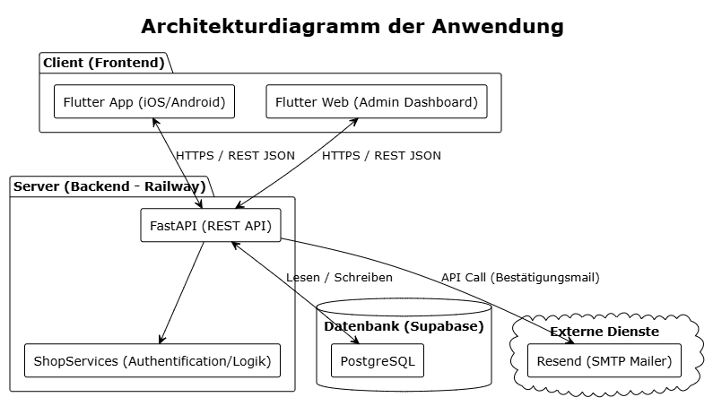
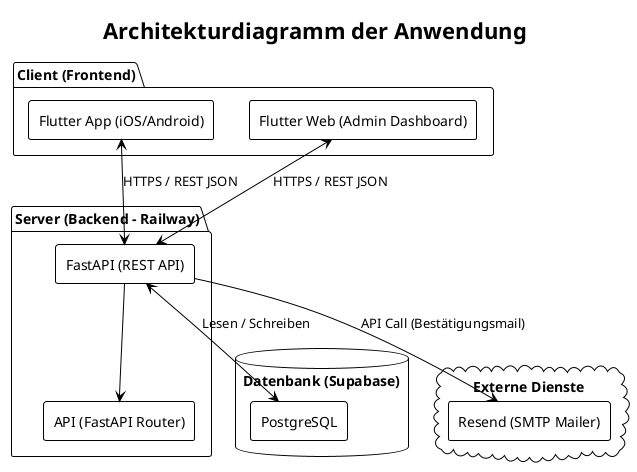
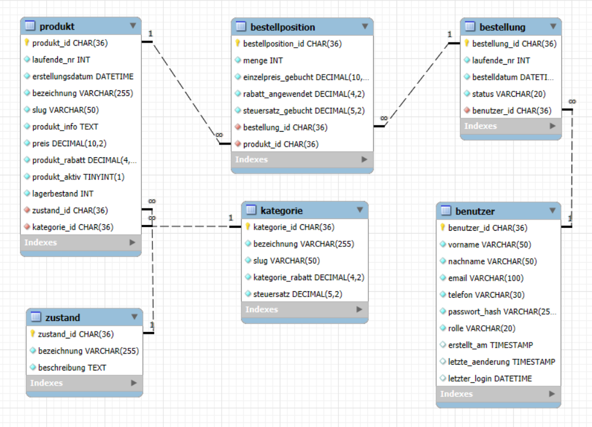
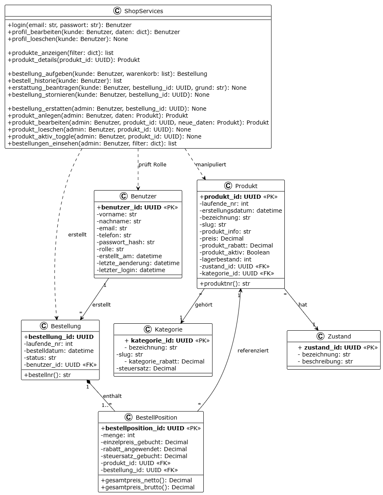
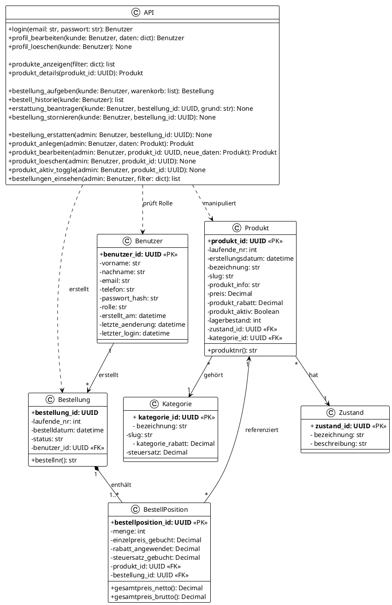

---
tags:
  - src/gfn
  - status/active
  - topic/flutter
  - topic/python
  - topic/ihk
  - focus
  - type/project/thriftshop
created: 2026-03-29 22:06
updated: 2026-04-04 22:42
deadline: 2026-04-01
priority: 1 🔴
---
 # Projektdokumentation

>[[_MOC_workbench]]

**Related**: [[thriftshop_projektantrag]], [[thriftshop_ui_guideline]], [[ihk_abschlussprojekt]], [[ihk_projektantrag_bestandteile]]

---
## 1 Einleitung

### 1.1 Projektumfeld
Auftraggeber ist die Thriftshop Köln GmbH, ein kleines, nachhaltiges Unternehmen mit Sitz in Köln. Das Kerngeschäft umfasst den Ankauf, die Aufbereitung und den Wiederverkauf von Second-Hand-Kleidung, Haushaltsgeräten und Dekorationsartikeln. Das Unternehmen ist seit drei Jahren am Markt und verzeichnet ein kontinuierliches Wachstum seines Kundenstamms.

Der bisherige Verkaufsprozess ist rein stationär und wird größtenteils manuell auf Papier dokumentiert. Es existiert keine digitale Lösung zur Produktverwaltung oder Bestellerfassung. Mit zunehmendem Wachstum stößt dieses Vorgehen an seine Grenzen: Kunden haben keinen Überblick über das aktuelle Sortiment, und Bestellungen müssen persönlich oder telefonisch aufgegeben werden. Dies führt zu ineffizienten Prozessen und eingeschränkter Reichweite.

### 1.2 Projektziel
- Schaffung einer digitalen Verkaufsplattform zur Präsentation des Second-Hand-Sortiments der Thriftshop Köln GmbH.
- Ermöglichung von Online-Bestellungen für Kunden unabhängig von Ort und Öffnungszeiten.
- Sicherstellung eines strukturierten Zugangs durch ein Login-System mit Rollenverwaltung für Kunden und Administratoren.
- E-Mail-Benachrichtigungen an Kunden versenden (Bestellung, Kontoerstellung, -löschung oder -bearbeitung). 
- Alle Bestell- und Produktdaten werden in einer relationalen Datenbank gespeichert.

### 1.3 Projektbegründung
Bisher arbeitet der Thriftshop Köln nur vor Ort und nutzt Papier für die Verwaltung. Das ist sehr zeitaufwendig, fehleranfällig und macht es schwierig, den Überblick über die Waren zu behalten. Um weiter wachsen zu können, ist eine digitale Lösung notwendig.

Die Vorteile des neuen Systems sind:

- **Effizienteres Arbeiten:** Durch die digitale Datenbank fallen Zettelwirtschaft und manuelle Fehler weg. Bestände und Bestellungen werden automatisch und sicher verwaltet.
- **Mehr Reichweite:** Kunden können das Sortiment rund um die Uhr online einsehen und bestellen – unabhängig von Öffnungszeiten oder Standort.
- **Zukunftssichere Technik:** Die gewählten Technologien (Flutter, FastAPI) sind modern und erweiterbar. Neue Funktionen wie Online-Zahlung können später ohne großen Aufwand ergänzt werden.

Damit kann sich der Thriftshop von einem rein stationären Laden zu einem modernen Online-Anbieter entwickeln.


### 1.4 Projektschnittstellen
Das Projekt hat folgende Verbindungspunkte (Schnittstellen):

**1. Technische Schnittstellen**
- **App ↔ Server:** Die Flutter-App kommuniziert über HTTPS mit dem FastAPI-Backend (REST/JSON).
- **Backend ↔ Datenbank:** Das Backend liest und schreibt Produkt-, Bestell- und Benutzerdaten in der Datenbank.
- **Backend → E-Mail:** Das Backend ruft den E-Mail-Dienst Resend auf, um automatisch Bestätigungen zu versenden.

**2. Benutzerschnittstellen**
- **Kunden:** Nutzen die App, um das Sortiment zu durchsuchen und Bestellungen aufzugeben.
- **Administratoren:** Nutzen einen geschützten Bereich, um Produkte und Bestellungen zu verwalten.

**3. Organisatorische Schnittstellen**
- **Auftraggeber:** Die Geschäftsführung der Thriftshop Köln GmbH wurde regelmäßig über Design- und Funktionsentscheidungen informiert.


### 1.5 Projektabgrenzungen

1. In dieser Version des Webshops wird keine Zahlungsfunktion entwickelt oder von Dritten integriert (z. B. PayPal). Zahlungen erfolgen per Rechnung/Überweisung (die Rechnung wird per E-Mail verschickt) oder vor Ort bei der Abholung.

2. Lieferfunktionen werden im Webshop nicht abgebildet. Die Liefermöglichkeiten müssen direkt per Nachricht oder telefonisch mit der Thriftshop Köln vereinbart werden. 


### 1.6 Allgemeine Bemerkungen

Datenschutz: Alle persönlichen Daten (z. B. Passwörter) werden verschlüsselt gespeichert. Es werden nur die Daten erhoben, die für die Bestellung unbedingt notwendig sind (gemäß DSGVO).

Erweiterbarkeit: Das System ist modular aufgebaut. Das bedeutet, dass man später sehr einfach neue Funktionen wie Online-Zahlung (PayPal) oder einen Versand-Service hinzufügen kann.

Test-Daten: Für die Entwicklung und die Tests wurden realitätsnahe Beispieldaten verwendet. So konnte die Suche und Filterung der Produkte schon vor dem echten Start ausgiebig geprüft werden.

---
## 2 Projektplanung

### 2.1 Projektphasen

**1. Definition (Gesamtzeit: 12 h)**

- 1.1 Ist-Analyse (Problemanalyse) (2 h)
- 1.2 Wirtschaftlichkeitsbetrachtung (2 h)
- 1.3 Anforderungen analysieren (2 h)
- 1.4 Use-Case-Analyse (2 h)
- 1.5 Lasten- und Pflichtenheft erstellen (4 h)

**2. Planung (Gesamtzeit: 12 h)**

- 2.1 Arbeitspakete erstellen (Projektstrukturplan) (2 h)
- 2.2 Kosten- und Zeitplan erstellen (2 h)
- 2.3 Datenbankmodellierung inkl. ER-Modell (3 h)
- 2.4 Entwurf der Systemarchitektur mit Klassendiagramm (3 h)
- 2.5 Erstellung der UI-Mockups (2 h)

**3. Realisierung (Gesamtzeit: 38 h)**

- 3.1 Einrichtung der Entwicklungsumgebung und Datenbankstruktur (2 h)
- 3.2 Implementierung der Datenbankzugriffe (CRUD-Operationen) (4 h)
- 3.3 Implementierung des Login-Systems mit Authentifizierung und Rollenverwaltung (7 h)
- 3.4 Entwicklung der Benutzeroberfläche (8 h)
- 3.5 Implementierung des Bestellsystems mit Validierung und E-Mail-Bestätigung (6 h)
- 3.6 Implementierung der Such- und Filterfunktion (4 h)
- 3.7 Unit-Tests (3 h)
- 3.8 Zeitpuffer (erhöhter Realisierungsaufwand) (4 h)

**4. Abschluss (Gesamtzeit: 18 h)**

- 4.1 System- und Integrationstest (3 h)
- 4.2 Code-Review (2 h)
- 4.3 Projektdokumentation (10 h)
- 4.4 Erstellung des Soll-Ist-Vergleichs (1 h)
- 4.5 Abnahme durch den Auftraggeber (1 h)
- 4.6 Schulung des Anwenders (1 h)

**Gesamtzeit des Projektes: 80 h**


**Projektstrukturplan**




**Gantt-Diagramm**


### 2.2 Ressourcenplanung

**Personalressourcen:**
- Umsetzung: Das Projekt wird komplett eigenständig von einer Person (Full-Stack-Entwicklung) geplant, entwickelt und getestet.
- Zeitaufwand: Der gesamte Arbeitsaufwand ist auf 80 h angesetzt. Darin enthalten ist ein Zeitpuffer von 4 h für das Risikomanagement.
- Zeitraum: Bei einer wöchentlichen Arbeitszeit von 20 h beträgt die Projektdauer insgesamt 4 Wochen.

**Technische Ressourcen:**
- Hardware: Ein Windows-PC (16GB RAM - 500GB SSD - Intel Core i5) für die Programmierung sowie ein Smartphone (Android/iOS) zum Testen der App unter realen Bedingungen.
- Entwicklung: Visual Studio Code wird als Editor genutzt. Die Versionierung des Codes erfolgt über Git & GitHub.
- Datenbank-Tools: Für den Entwurf und die Verwaltung der Tabellen wird die MySQL Workbench eingesetzt.
- Planung: Diagramme werden mit PlantUML und Draw.io erstellt. Notizen und Fachwissen werden in Obsidian gesammelt.
- Dokumentation: Die fertige Arbeit wird in Microsoft Word erstellt.

**Infrastruktur & Externe Dienste:**
Damit die Anwendung online funktioniert, werden folgende kostenlose Dienste genutzt:
- Backend-Server: Das Python-Backend (FastAPI) läuft auf der Plattform Railway. So ist die Schnittstelle immer erreichbar.
- Datenbank: Als Hauptspeicher dient Supabase (PostgreSQL). Während der Entwicklung wird zusätzlich eine lokale Datenbank (MySQL) zum Testen verwendet.
- Web-Hosting: Das Frontend der App wird über GitHub Pages veröffentlicht. Dies bietet automatisch eine sichere Verschlüsselung (SSL).
- E-Mail-Versand: Automatische Bestätigungen werden über den Dienst Resend verschickt. Für die Anmeldung von Benutzern wird das eingebaute E-Mail-System von Supabase Auth genutzt.


### 2.3 Entwicklungsprozess 

Da es sich bei dem geplanten Webshop um ein kleines Projekt mit fest definierten Anforderungen, Phasen und einem überschaubaren Gesamtaufwand von 80 Stunden handelt, wird ein klassisches Vorgehensmodell in Form des Wasserfallmodells gewählt. 

Die Projektphasen (Definition, Planung, Realisierung, Abschluss) werden streng sequenziell abgearbeitet. Eine neue Phase beginnt typischerweise erst, wenn die vorherige vollständig abgeschlossen und dokumentiert wurde. Für die Versionierung und Sicherung des Quellcodes wird Git (GitHub) eingesetzt, um Änderungen jederzeit nachvollziehen zu können.

### 2.4 Risikomanagement

Bei der Projektplanung wurden mögliche Risiken bewertet und Gegenmaßnahmen festgelegt:

| Risiko                                                  | Wahrscheinlichkeit | Auswirkung | Gegenmaßnahme                                                                                                    |
| ------------------------------------------------------- | ------------------ | ---------- | ---------------------------------------------------------------------------------------------------------------- |
| Aufwandsunterschätzung                                  | Mittel             | Hoch       | 4 Stunden Zeitpuffer in der Realisierungsphase eingeplant                                                        |
| Technische Probleme (z. B. Bibliotheksinkompatibilität) | Mittel             | Mittel     | Frühzeitiger Test der Kernbibliotheken; Alternativen evaluiert                                                   |
| Ausfall externer Dienste (Railway, Supabase, Resend)    | Gering             | Hoch       | Lokale Entwicklungsumgebung unabhängig von Cloud-Diensten; kostenlose Alternativen verfügbar                     |
| Gerätespezifische Fehler der Flutter-App                | Mittel             | Mittel     | Tests auf physischen Geräten ab früher Realisierungsphase                                                        |
| Datenverlust durch fehlerhaftes Datenbankskript         | Gering             | Hoch       | `CREATE TABLE IF NOT EXISTS` verhindert unbeabsichtigtes Überschreiben; Quellcode vollständig in Git versioniert |

---

## 3 Analysephase

### 3.1 Ist-Analyse
Der Thriftshop Köln arbeitet aktuell rein stationär und nutzt größtenteils manuelle Papierdokumentation für die Verwaltung der Second-Hand-Waren und Bestellungen. Es existiert keine digitale Lösung zur Produktübersicht für Kunden oder zur internen Bestandsaufnahme. Dieses Vorgehen ist fehleranfällig, zeitaufwendig und beschränkt die Reichweite des Unternehmens stark auf Laufkundschaft vor Ort, da Artikel nicht online eingesehen werden können.

### 3.2 Wirtschaftlichkeit
#### 3.2.1 Make or Buy-Entscheidung
Vor Beginn des Projekts wurde abgewogen, ob eine Standard-Shop-Lösung (Buy - z.B. Shopify) oder eine Eigenentwicklung (Make) sinnvoller ist. 

Bei einer **Buy-Lösung (Shopify)** würden dauerhaft laufende Fixkosten entstehen:
- Die Basisversion ("Basic Shopify") kostet in Deutschland aktuell ca. 36 € im Monat (zzgl. MwSt.). 
- Hinzu kommen umsatzabhängige Transaktionsgebühren (bis zu 2 % bei Nutzung externer Zahlungsmittel) sowie vielfach monatliche Kosten für Drittanbieter-Plugins, da Funktionen wie das individuell angeforderte Rollensystem im Basis-Plan oft nicht nahtlos integrierbar sind. Auf ein Jahr gerechnet lägen die reinen Fixkosten bei über 430 € (ohne versteckte Zusatzkosten).

Eine **Eigenentwicklung (Make)** mit Flutter und FastAPI erfordert zwar einen initialen Entwicklungsaufwand (80 Stunden), bietet jedoch langfristig massive Kostenvorteile. Durch die konsequente Nutzung von Open-Source-Technologien und kostenfreien Cloud-Ressourcen (Free Tiers bei Railway, Supabase und GitHub Pages) bleiben die monatlichen Betriebskosten bei 0,00 € oder, bei optionalen Upgrades auf kostenpflichtige Basistarife, voraussichtlich unter 10 € pro Monat. Gleichzeitig ist das System voll auf die Thriftshop-Anforderungen (keine Direktzahlungen, spezielles Admin/Kunden-System) maßgeschneidert. 

Daher fiel die Entscheidung eindeutig auf die Eigenentwicklung.

#### 3.2.2 Projektkosten
Die Kosten des Projekts entstehen hauptsächlich durch den internen Personalaufwand (eigene Arbeitszeit sowie Unterstützung durch interne Entwickler), da auf teure Server- und Lizenzkosten verzichtet wird:
- **Entwicklungskosten:** 80 Stunden × 15 €/h = 1.200 €. (Meine Firma Fragen)
- **Code Review:** Prüfung durch einen internen Softwareentwickler (5 Stunden × 140 €/h) = 700 €.
- **Gesamte Entwicklungskosten:** 1.900 €.
- **Laufende Infrastrukturkosten:** 0,00 € pro Monat (Nutzung von Railway Free Tier, Supabase, GitHub Pages und Resend).
- **Fremdkosten (App Stores - Optional):** Falls die App später in die Stores soll: Apple Developer (99 $/Jahr), Google Play (25 $ einmalig).

#### 3.2.3 Amortisationsdauer
Da die laufenden Betriebskosten faktisch entfallen, bemisst sich die Amortisation der Entwicklungskosten (1.900 €) an der eingesparten Arbeitszeit. Spart die digitale Verwaltung pro Woche ca. 3 Arbeitsstunden (à 20 €) ein, so werden 60 € pro Woche gespart. Die Gesamtentwicklungskosten von 1.900 € haben sich somit nach ca. 32 Wochen (rund 8 Monaten) amortisiert.

**Amortisationsverlauf**


### 3.3 Lastenheft/ Fachkonzept
Bei diesem Projekt wurde vom Auftraggeber kein klassisches Lastenheft vorgegeben. Das Problem, die gewünschten Lösungen, das Budget und die Ressourcen wurden stattdessen in einem Fachgespräch ermittelt und festgehalten. 

Es handelt sich um einen Webshop, der den gesamten Verkaufs- und Verwaltungsprozess der Thriftshop Köln GmbH durch folgende Maßnahmen vereinfachen und digitalisieren soll:

**1. Digitalisierung des Sortiments:**
- Schaffung einer Plattform, auf der Kunden das Second-Hand-Sortiment jederzeit online einsehen können, unabhängig von den stationären Öffnungszeiten.
- Implementierung von Such- und Filterfunktionen zur besseren Übersicht.

**2. Digitale Bestellabwicklung:**
- Kunden können online verbindliche Bestellungen aufgeben, was den manuellen Aufgabenaufwand vor Ort reduziert und Fehler (Zettelwirtschaft) minimiert.
- Etablierung eines automatisierten E-Mail-Systems (Versand von Bestätigungen bei Bestellung, Registrierung oder Kontoänderung).

**3. Verwaltung und Datensicherheit:**
- Ein sicheres Login-System mit Rollenverwaltung zur strikten Trennung zwischen Kunden (Kauf) und Administratoren (Verwaltung).
- Mitarbeiter erhalten einen geschützten Admin-Bereich, um Bestände, Produkte und eingehende Bestellungen zentral in einer relationalen Datenbank zu verwalten.
- Alle Kundendaten werden gemäß DSGVO verwaltet (inkl. Passwortverschlüsselung).

**Abgrenzung:**
- Der Webshop beinhaltet **keine** direkte Zahlungsfunktion (Abwicklung erfolgt auf Rechnung oder vor Ort).
- Es ist **kein** Liefer- oder Versandprozess integriert (Vereinbarungen manuell via Nachricht/Telefon).





---

## 4 Entwurfsphase

### 4.1 Zielplattform
Die Anwendung ist auf eine plattformübergreifende Nutzung ausgelegt:
- **Client (Frontend):** Eine native Cross-Platform-App für iOS und Android (sowie als Web-Applikation), entwickelt mit dem Framework **Flutter**. Die Web-Version wird primär für das Admin-Dashboard über GitHub Pages bereitgestellt.
- **Server (Backend):** Eine RESTful-API, entwickelt in **Python (FastAPI)**, gehostet in der Cloud bei **Railway**.
- **Datenbank:** Entwicklung mit MySQL relationale Datenbank, produktiv betrieben mit **PostgreSQL (Supabase)**.

### 4.2 Architekturdesign
Das System folgt einer klassischen Client-Server-Architektur, die sich physisch und logisch in drei Hauptkomponenten (Schichten) aufteilt:

1. **Präsentationsschicht (Client/Frontend):** 
   Die Benutzeroberfläche wird durch eine plattformübergreifende Flutter-Anwendung bereitgestellt. Der Client speichert selbst keine dauerhaften Geschäftsdaten, sondern fordert diese nur bei Bedarf an und stellt sie dar. Er reagiert auf Nutzereingaben und sendet entsprechende asynchrone HTTP-Requests (REST via JSON) an den Server.

2. **Logikschicht (Server/Backend):** 
   Das Herzstück der Anwendung ist eine RESTful-API, geschrieben in Python (FastAPI), die später auf der Cloud-Plattform Railway gehostet wird. Dieser Server nimmt alle Anfragen der Clients entgegen, authentifiziert den Nutzer und führt die eigentliche Geschäftslogik durch. Beispielsweise prüft er bei einer Bestellung, ob der angefragte Artikel noch auf Lager ist. Zudem steuert das Backend externe Dienste an, beispielsweise den SMTP-Mailer (Resend), um automatisch Bestätigungs-E-Mails zu versenden.

3. **Datenhaltungsschicht (Datenbank):** 
   Das FastAPI-Backend kommuniziert sicher mit einer PostgreSQL-Datenbank, die von Supabase in der Cloud gehostet wird. Für die Entwicklung und das Testing wird zunächst eine MySQL-Datenbank verwendet. Hier werden alle persistenten Daten, wie Benutzerprofile, das Produktinventar und die Bestellungen, zentral verwaltet. Ein direkter Zugriff des Frontends auf die Datenbank ist aus Sicherheitsgründen technisch ausgeschlossen; die API dient als verbindlicher "Türsteher".





### 4.3 Datenmodell
Das objektorientierte Datenmodell der Anwendung besteht aus sechs Klassen, die die Struktur der gespeicherten Daten abbilden.

- Benutzer: Repräsentiert einen registrierten Kunden oder Mitarbeiter. Neben persönlichen Stammdaten (Name, E-Mail, Telefon) wird das Passwort ausschließlich als kryptografischer Hash (bcrypt) gespeichert. Das Attribut `rolle` wird auf Datenbankebene durch einen CHECK-Constraint auf die Werte „Administrator“, „Mitarbeiter“ und „Kunde“ beschränkt. Diese Rolle dient im Backend als Basis für die autorisierte Zugriffskontrolle (RBAC – Role-Based Access Control). Ein Benutzer steht in einer 1:n-Beziehung zu Bestellungen.

- Produkt: Bildet einen physischen Verkaufsartikel ab. Jedes Produkt verfügt über eine eindeutige UUID, eine menschenlesbare `produktnr`, sowie den preis und einen optionalen `produkt_rabatt` (jeweils als Decimal). Das Flag `produkt_aktiv` steuert die Sichtbarkeit im Frontend. Ein Produkt ist über Foreign Keys fest genau einer Kategorie und einem Zustand zugeordnet.

- Kategorie: Gruppiert Produkte thematisch (z. B. Kleidung, Medien). Sie kann einen `kategorie_rabatt` besitzen. Die Logik prüft zur Laufzeit via `MAX()`, ob der produkt- oder kategoriespezifische Rabatt für den Endpreis angewendet wird.

- Zustand: Definiert den physischen Erhaltungsgrad eines Artikels (z. B. „wie neu“, „stark gebraucht“). Dies ist im Thriftshop-Kontext entscheidend für die Preisfindung und Transparenz gegenüber dem Käufer.

- Bestellung: Repräsentiert einen abgeschlossenen Kaufvorgang. Sie ist fest mit einem Benutzer verknüpft und enthält Metadaten wie die `laufende_nr`, das `bestelldatum` und den aktuellen `status`. Letzterer wird per Datenbank-Constraint auf valide Werte („Offen“, „In Bearbeitung“, „Abgeschlossen“, „Storniert“, „Erstattet“) limitiert. Die Beziehung zu den Positionen ist als Komposition implementiert: Das Löschen einer Bestellung führt kaskadierend zum Löschen aller zugehörigen Positionen (Referenzielle Integrität).

- BestellPosition: Fungiert als Assoziationsklasse, um die m:n-Beziehung zwischen Bestellung und Produkt aufzulösen. Sie speichert einen Snapshot der Daten zum Kaufzeitpunkt (`einzelpreis_gebucht`, `rabatt_angewendet`, `steuersatz_gebucht`). Dies stellt sicher, dass die Buchhaltung auch bei nachträglichen Preis- oder Steuersatzänderungen am Stammprodukt konsistent bleibt. Die Klasse enthält zudem die Geschäftslogik zur Berechnung der `gesamtpreis_netto()` und `gesamtpreis_brutto()` Werte der jeweiligen Position.



Die **API-Schicht** steht stellvertretend für die FastAPI-Router (`api/auth.py`, `api/benutzer.py`, `api/produkte.py` usw.). In der Implementierung ist die Logik nach Fachdomäne auf sieben Router-Module aufgeteilt. Die DAOs wurden im Diagramm weggelassen, um die Übersicht zu wahren.





### 4.4 UI-Design

Die Benutzeroberfläche durchlief zwei Entwurfsstufen. Zunächst wurden alle Screens als **Wireframe** mit Draw.io skizziert, um Seitenstruktur, Navigation und die Anordnung der Elemente festzulegen – ohne Farben oder Details. Auf Basis dieser Wireframes wurde anschließend mithilfe des KI-Modells **Google Gemini** ein **HTML-Mockup** erstellt, das das finale Design mit Farbschema, Schriften und Abständen abbildet. Das Mockup wurde abschließend als PDF exportiert. Es befindet sich im Anhang.

### 4.5 Test-Konzept
Zur Gewährleistung der Softwarequalität werden verschiedene Teststufen definiert:
- **Unit-Tests (Backend):** Die einzelnen FastAPI-Endpunkte und Geschäftslogiken werden isoliert (z.B. mit `pytest`) geprüft.
- **Integrationstests:** Das Zusammenspiel zwischen Backend und Datenbank wird automatisiert getestet.
- **Manuelle Systemtests (Frontend):** Auf physischen Testgeräten (Android/iPhone) werden die UI/UX und Nutzerführungen (Registrierung -> Artikel in Warenkorb -> Bestellung) manuell durchgespielt.

### 4.6 Pflichtenheft

Das Pflichtenheft beschreibt, wie die im Fachkonzept (3.3) gestellten Kundenanforderungen technisch umgesetzt werden.

#### Anforderung 1: Digitalisierung des Sortiments

- **Sortiment jederzeit online einsehbar**  
  Die Flutter-App ruft beim Start die Produktliste über den Endpunkt `GET /produkte` vom FastAPI-Backend ab. Dieser Endpunkt ist öffentlich zugänglich und erfordert keinen Login, sodass Kunden das Sortiment jederzeit und von überall einsehen können. Die Produkte werden in einem `GridView` dargestellt.

- **Such- und Filterfunktion mit Provider-Integration**  
  Die Produktliste (`ProduktlisteScreen`) rendert alle aktiven Produkte in einem responsiven `GridView` mit individuellen Produktkarten. Jede Karte zeigt Produktbild, Titel, Preis, Kategorie (via `KategorieService`) und Zustand (via `ZustandService` mit farbigen Badges). Die Daten werden über `ProductProvider` (ChangeNotifier) verwaltet, der API-Antworten in lokale Modell-Instanzen transformiert.

  Eine `SearchBar` in der AppBar ruft beim Tippen `productProvider.filterBySearch()` auf. Der Provider sendet einen GET-Request an `/produkte?search=<begriff>` und aktualisiert die angezeigte Liste. Der Suchbegriff wird live im Backend gefiltert.

  Kategorie-Filter werden als `FilterChip`-Widgets gerendert. Die Kategorien werden zur Laufzeit von `KategorieService` aus der API geladen und im Speicher gecacht. Kein Hardcoding mehr im Frontend. Der Benutzer kann eine Kategorie auswählen, woraufhin `productProvider.filterByCategory()` den API-Call `/produkte?kategorie_id=<uuid>` auslöst und die Liste aktualisiert.

  Der `ZustandService` mapped `Zustand`-IDs zu farbigen Badges: Neu → grün,gebraucht → blau, angerissen → orange, pitch → lila. Die Farben werden direkt in den Produktkarten verwendet.

  Die Produktliste unterstützt Pull-to-Refresh über `RefreshIndicator`. Während des Ladens wird ein `CircularProgressIndicator` angezeigt, bei Fehlern eine Fehlermeldung mit Retry-Button.

#### Anforderung 2: Digitale Bestellabwicklung

- **Online-Bestellungen aufgeben**  
  Der Kunde legt Artikel in den Warenkorb, dessen Inhalt lokal im Flutter App-State gespeichert wird. Auf dem Checkout-Screen sieht der Kunde eine Übersicht und bestätigt die Bestellung. Die App sendet daraufhin einen `POST /bestellungen`-Request mit den Artikeln und der Kunden-ID an das Backend, welches die Bestellung in der Datenbank anlegt.

- **Automatische E-Mail-Bestätigung bei Bestellung**  
  Nach erfolgreichem Anlegen der Bestellung in der Datenbank ruft das FastAPI-Backend den externen E-Mail-Dienst Resend per SMTP auf. Dieser versendet automatisch eine Bestätigungsmail mit der Bestellnummer, den bestellten Artikeln und Gesamtpreis an die hinterlegte Kunden-E-Mail-Adresse. In der E-Mail sind auch die Zahlungsdaten enthalten (falls keine Vor-Ort-Zahlung ausgewählt wurde).

- **E-Mail bei Registrierung und Kontoänderung**  
  Bei der Registrierung versendet Supabase Auth automatisch eine Bestätigungsmail. Bei späteren Kontoänderungen (Daten bearbeiten, Konto löschen) triggert das FastAPI-Backend nach der Datenbankoperation jeweils einen eigenen Resend-Aufruf, um den Kunden per E-Mail zu informieren.

#### Anforderung 3: Verwaltung und Datensicherheit

- **Login-System mit Rollenverwaltung**  
  Die Authentifizierung erfolgt über Supabase Auth, das nach erfolgreichem Login einen signierten JWT-Token ausstellt. Die Benutzerrolle (`ADMIN`, `MITARBEITER` oder `KUNDE`) ist im Token hinterlegt. Die Flutter-App speichert den Token lokal und sendet ihn bei jedem API-Request im Authorization-Header mit. Das FastAPI-Backend prüft bei jedem Request die Gültigkeit und Rolle des Tokens. Da es sich um ein kleines Unternehmen handelt, ist die Benutzerrolle `Mitarbeiter` zunächst inaktiv. Bei Bedarf kann sie als Alternative zum Administrator mit eingeschränkten Berechtigungen aktiviert werden. 

- **Geschützter Admin-Bereich**   
  Alle Aktionen, die Daten in der Datenbank verändern (Produkte erstellen, ändern, löschen oder Bestellungen aktualisieren) mit `POST`, `PUT`, `DELETE`, `PATCH`, sind im Backend per Dependency-Injection geschützt. Diese Funktion prüft automatisch bei jeder Anfrage, ob der Benutzer die nötigen Rechte hat, bevor die Aktion ausgeführt wird. Anfragen ohne gültigen Admin-Token werden mit HTTP `403 Forbidden` abgewiesen. Im Frontend wird die Admin-Navigation nur angezeigt, wenn die Rolle im Token `ADMIN` ist.

- **Zentrale relationale Datenbank**  
  Alle persistenten Daten werden in einer PostgreSQL-Datenbank auf Supabase gespeichert. Die Tabellen entsprechen dem Klassendiagramm (Abschnitt 4.3): `benutzer`, `produkt`, `kategorie`, `zustand`, `bestellung`, `bestellposition`. Ein direkter Zugriff vom Frontend auf die Datenbank ist technisch ausgeschlossen. Alle Anfragen laufen ausschließlich über das FastAPI-Backend.

- **Datenschutz, Datensicherheit und rechtliche Rahmenbedingungen**  
  Passwörter werden ausschließlich als bcrypt-Hash gespeichert (`passlib`-Bibliothek) mit eingebautem Salting. Es wird kein Klartext-Passwort in der Datenbank abgelegt oder über das Netzwerk übertragen. Für Bestellungen werden nur die Daten erhoben und verarbeitet, die für den rechtmäßigen Zweck notwendig sind (Vorname, Nachname, E-Mail, Telefon).
  Eine Datenschutzerklärung ist vorhanden, um das Recht auf Information über die Verarbeitung der Daten zu gewährleisten. Der Benutzer muss dieser Datenschutzerklärung zustimmen. Der Benutzer hat zudem das Recht auf Datenübertragbarkeit, Löschung (Recht auf Vergessenwerden) und Widerspruch, und kann jederzeit seine Einwilligung zur Verarbeitung personenbezogener Daten widerrufen. Für weitere DSGVO-konforme Regelungen muss sich die Thriftshop Köln GmbH von einem Anwalt beraten lassen.
  Allgemeine Geschäftsbedingungen (AGB) mit den entsprechenden rechtlichen Anforderungen müssen ebenfalls von der Thriftshop Köln GmbH zur Verfügung gestellt werden. Diese werden auf einer dedizierten Webseite für den Benutzer angezeigt und müssen beim Kauf vom Kunden akzeptiert werden. Darüber hinaus sind ein Impressum sowie ein Cookie-Banner vorhanden. Der Cookie-Banner wird beim Öffnen der Website angezeigt, sodass der Benutzer seine Präferenzen auswählen und seine Einwilligung erteilen kann.


#### Abgrenzung (Nicht-Ziele, unverändert)

- Keine Zahlungsfunktion – Rechnung wird per E-Mail versendet oder Zahlung erfolgt vor Ort.
- Kein Versandprozess – Absprache erfolgt manuell per Telefon oder Nachricht.

---

## 5 Implementierungsphase

### 5.1 Projektstruktur

Das Projekt besteht aus einem Python-Backend und einer Flutter-App. Die Struktur folgt dem Prinzip der **Separation of Concerns**: Datenmodelle, Datenbankzugriff und Geschäftslogik sind im Backend klar voneinander getrennt. Das Frontend ist nach Feature-Modulen gegliedert.

```
backend/
├── models/               # Python-Datenmodelle (@dataclass)
│   ├── benutzer.py, bestellung.py, bestellposition.py
│   ├── kategorie.py, produkt.py, zustand.py
│   └── __init__.py       # Exportiert alle Klassen
├── dao/                  # Datenbankzugriff (CRUD)
│   ├── benutzer_dao.py, bestellung_dao.py, produkt_dao.py
│   └── __init__.py
├── services/
│   └── shop_services.py  # Geschäftslogik
├── init_db.py            # Datenbankinitialisierung
└── main_test.py          # Tests

frontend/
├── lib/
│   ├── main.dart         # App-Entry, MultiProvider, Router-Setup
│   ├── router.dart       # go_router Routenkonfiguration
│   ├── core/
│   │   ├── constants/    # Design-Tokens (Abstände, Radien, Farben)
│   │   ├── network/      # API-Client (Dio + JWT-Interceptor)
│   │   ├── router/       # Routen-Handler
│   │   └── theme/        # ThemeData (Farben, Schriften, M3-Design)
│   ├── models/           # DTOs für API-Response-JSON-Daten
│   ├── providers/        # ChangeNotifier-Provider (Zustandsverwaltung)
│   │   ├── auth_provider.dart
│   │   ├── product_provider.dart
│   │   ├── cart_provider.dart
│   │   ├── order_provider.dart
│   │   └── profile_provider.dart
│   ├── screens/          # UI-Screens (Page-Routen)
│   │   ├── auth/         # Login, Registrierung
│   │   ├── produkte/     # Produktliste (Screen 2)
│   │   ├── warenkorb/    # Warenkorb
│   │   ├── bestellung/   # Bestellhistorie / Checkout
│   │   └── profil/       # Profilverwaltung
│   ├── services/         # Business Services & API-Wrapper
│   │   ├── api_service.dart
│   │   ├── auth_service.dart
│   │   ├── kategorie_service.dart
│   │   └── zustand_service.dart
│   └── widgets/          # Wiederverwendbare UI-Komponenten
├── pubspec.yaml          # Abhängigkeiten
└── test/                 # Widget- und Integrationstests
```

**Wichtige Designentscheidungen:**

- **Slugs:** `Kategorie` und `Produkt` nutzen Slugs für lesbare URLs (z. B. `/kategorie/kleidung/vintage-levis-jeansjacke`).
- **Preis-Snapshots:** `BestellPosition` speichert Preis, Rabatt und Steuersatz zum Kaufzeitpunkt, damit Buchungen auch bei späteren Preisänderungen korrekt bleiben.
- **Lesbare Nummern:** `Produkt` und `Bestellung` formatieren ihre laufende Nummer per `@property` in einen lesbaren String (z. B. `P00012`, `B00003`).
- **Validierung auf Datenbankebene:** Bestellstatus und Benutzerrolle werden per `CHECK`-Constraint direkt in der Datenbank validiert.

### 5.2 Datenbank und Datenmodelle

Das Skript `init_db.py` erstellt per `mysql.connector` die Datenbank `thriftshop` mit sechs Tabellen. Verbindungsdaten werden aus einer `.env`-Datei geladen (`python-dotenv`), sodass keine sensiblen Daten im Quellcode stehen.

| Tabelle           | Besonderheiten                                                   |
| ----------------- | ---------------------------------------------------------------- |
| `benutzer`        | `CHECK`-Constraint auf Rolle; Passwort als bcrypt-Hash           |
| `zustand`         | Referenziert von `produkt`                                       |
| `kategorie`       | Slug, Rabatt und Steuersatz                                      |
| `produkt`         | FK auf `zustand` und `kategorie`; `ON DELETE RESTRICT`           |
| `bestellung`      | `CHECK`-Constraint auf Status; `ON DELETE RESTRICT` auf Benutzer |
| `bestellposition` | Preis-Snapshot; `ON DELETE CASCADE` beim Löschen der Bestellung  |

Die Python-Klassen in `models/` spiegeln diese Tabellen als `@dataclass` wider. Der Dekorator generiert Konstruktor, Vergleichsmethoden und `__repr__` automatisch. Wichtige Details:

- **UUID** (`uuid4()`): Jede Entität besitzt eine eindeutige ID, die als `CHAR(36)` gespeichert wird – eine statische Zeichenkette mit genau 36 Zeichen.
- **Decimal** statt `float`: Verhindert Rundungsfehler bei Geldbeträgen.
- **Properties:** `BestellPosition` berechnet Netto- und Bruttopreis dynamisch über den `@property`-Dekorator. So werden die Werte bei Bedarf berechnet, ohne sie separat zu speichern.

Alle Klassen werden über `models/__init__.py` exportiert und können mit `from models import Produkt, Benutzer` importiert werden.

### 5.3 Datenbankzugriff (DAO)

Für den Datenbankzugriff wurde das **DAO-Pattern** eingesetzt. Jede Entität hat ein eigenes DAO (z. B. `ProduktDAO`, `BenutzerDAO`), das alle SQL-Abfragen kapselt. Die Geschäftslogik enthält dadurch kein SQL. Das erleichtert die spätere Migration auf PostgreSQL (nur DAOs müssen angepasst werden) und ermöglicht isolierte Tests mit einer Testdatenbank.

Die Datenbankverbindung wird per Dependency Injection übergeben:

```python
class ProduktDAO:
    def __init__(self, db_connection):
        self.conn = db_connection
```

### 5.4 Funktionslogik (API-Router)

Die FastAPI-Router bündeln die gesamte Geschäftslogik. Sie nutzen die DAOs für Datenbankzugriffe und die Datenmodelle als Datenträger. Die Endpunkte sind in vier Gruppen unterteilt:

**Authentifizierung und Profil:** Verwaltet den Login und die Profildaten eines Benutzers. `login()` prüft E-Mail und Passwort-Hash und gibt bei Erfolg das `Benutzer`-Objekt zurück. `profil_bearbeiten()` und `profil_loeschen()` aktualisieren bzw. entfernen den Datensatz und lösen jeweils eine E-Mail-Benachrichtigung aus.

**Katalog und Suche:** `produkte_anzeigen()` nimmt ein Filter-Dictionary entgegen (z. B. Kategorie, Suchbegriff, Preisspanne) und gibt die gefilterte Produktliste zurück. `produkt_details()` liefert alle Informationen zu einem einzelnen Produkt anhand seiner UUID.

**Bestellprozess:** `bestellung_aufgeben()` verarbeitet den Warenkorb, legt die Bestellung mit allen Positionen in der Datenbank an und löst die Bestätigungsmail aus. Zusätzlich können Kunden eine Bestellung stornieren oder eine Erstattung beantragen.

**Admin-Funktionen:** Methoden wie `produkt_anlegen()`, `produkt_bearbeiten()` oder `bestellungen_einsehen()` erwarten als ersten Parameter ein `Benutzer`-Objekt mit der Rolle `ADMIN`. Fehlt diese Berechtigung, wird eine Exception geworfen, bevor irgendeine Aktion ausgeführt wird.

### 5.5 Migration auf PostgreSQL

Da die SQL-Logik vollständig in den DAOs gekapselt ist, beschränkt sich die Migration von MySQL auf PostgreSQL (Supabase) auf die Anpassung der Verbindungsparameter und kleinere SQL-Dialekt-Unterschiede. Alle Datenmodelle und die Geschäftslogik bleiben unverändert.

### 5.6 Frontend (Flutter)

Die Benutzeroberfläche ist eine plattformübergreifende Flutter-App (Material Design 3), die ausschließlich per REST/JSON mit dem Backend kommuniziert.

**Design:** Farben, Schriften und Abstände sind zentral in `app_theme.dart` und `design_tokens.dart` definiert. Hauptfarbe ist `#4CAF93` (Grün, passend zum nachhaltigen Charakter des Shops), Schriftart ist **Inter**.

**Responsives Layout:** Ein `LayoutBuilder` in der Root-Shell schaltet je nach Bildschirmbreite zwischen `NavigationBar` (unten, mobil) und `NavigationRail` (links, Desktop) um. Auf dem Desktop wird der Inhalt auf maximal 1200 px begrenzt.

**Routing:** `go_router` verwaltet alle Routen zentral. Nicht eingeloggte Nutzer werden auf `/login` weitergeleitet, Nicht-Admins aus dem Admin-Bereich auf die Startseite.

**Zustandsverwaltung:** `provider` mit `ChangeNotifier` trennt Logik und Darstellung. Die App verwendet `MultiProvider` in `main.dart`, um fünf Provider als `ChangeNotifierProvider` zu registrieren: `AuthProvider`, `ProductProvider`, `CartProvider`, `OrderProvider` und `ProfileProvider`. Zusätzlich werden zwei Services (`KategorieService` und `ZustandService`) als `SingleInstance`-Service registriert, die Daten aus der API laden und im Speicher cachen. Die Widgets greifen über `context.read<T>()` (Wert, kein Rebuild) oder `context.watch<T>()` (Rebuild bei Änderung) auf die Provider und Services zu.

**API-Anbindung:** `dio` sendet alle HTTP-Anfragen. Ein Interceptor hängt den JWT-Token automatisch an. `ApiService` kapselt die REST-Aufrufe für alle Endpunkte. Kategorieservice und Zustandservice laden die Daten einmal beim App-Start und cachen sie im Speicher, sodass Widgets über `context.read<KategorieService>().getKategorieName(id)` und `context.read<ZustandService>().getZustandColor(id)` auf cachierte Daten zugreifen können.

| Package              | Zweck                           |
| -------------------- | ------------------------------- |
| `provider`           | Zustandsverwaltung              |
| `go_router`          | Navigation                      |
| `dio`                | HTTP-Anfragen                   |
| `flutter_dotenv`     | Umgebungsvariablen              |
| `shared_preferences` | Lokale Datenspeicherung (Token) |

### 5.7 REST-API (FastAPI-Routen)

Das Backend stellt eine RESTful-API bereit, die mit dem Framework **FastAPI** entwickelt wurde. Die API ist in sieben Router aufgeteilt, die jeweils in einer eigenen Datei unter `backend/app/api/` liegen und in `app/main.py` registriert werden.

| Präfix | Datei | Kurzbeschreibung |
|---|---|---|
| `/auth` | `api/auth.py` | Registrierung und Login |
| `/benutzer` | `api/benutzer.py` | Benutzerverwaltung (CRUD, Passwort) |
| `/produkte` | `api/produkte.py` | Produktverwaltung (CRUD, Soft-Delete) |
| `/kategorien` | `api/kategorien.py` | Kategorien (CRUD, Slug-Suche) – wird vom Frontend geladen und gecacht |
| `/zustaende` | `api/zustaende.py` | Zustände (CRUD, Bezeichnungs-Suche) – wird vom Frontend geladen und gecacht |
| `/bestellungen` | `api/bestellungen.py` | Bestellungen und Statusverwaltung |
| `/bestellpositionen` | `api/bestellposition.py` | Bestellpositionen (nur Lesen) |

Alle Routen nutzen **Dependency Injection** (`Depends(get_db)`), um eine Datenbankverbindung aus dem Connection-Pool zu beziehen. Bei Fehlern wird die Verbindung automatisch in einem `finally`-Block geschlossen.

---

#### Authentifizierung (`/auth`)

| Methode | Endpunkt | Beschreibung | Erfolgscode |
|---|---|---|---|
| `POST` | `/auth/registrieren` | Legt einen neuen Benutzer an; das Passwort wird vor dem Speichern automatisch mit bcrypt gehasht | 201 |
| `POST` | `/auth/login` | Prüft E-Mail und Passwort; liefert bei Erfolg einen signierten JWT zurück | 200 |

Fehlerfall Login: Bei falschem Passwort oder unbekannter E-Mail antwortet die Route mit `401 Unauthorized`.

---

#### Benutzerverwaltung (`/benutzer`)

| Methode | Endpunkt | Beschreibung | Erfolgscode |
|---|---|---|---|
| `GET` | `/benutzer/` | Alle Benutzer paginiert abrufen (Admin-Dashboard); Parameter: `limit`, `offset` | 200 |
| `GET` | `/benutzer/{benutzer_id}` | Einzelnen Benutzer per UUID abrufen | 200 / 404 |
| `POST` | `/benutzer/` | Neuen Benutzer anlegen (direkter DB-Insert, ohne Passwort-Hashing) | 201 |
| `PUT` | `/benutzer/{benutzer_id}` | Stammdaten eines Benutzers aktualisieren (Name, E-Mail, Telefon, Rolle) | 200 |
| `PATCH` | `/benutzer/{benutzer_id}/passwort` | Passwort-Hash eines Benutzers aktualisieren; Parameter: `neues_passwort_hash` (Query) | 200 |
| `DELETE` | `/benutzer/{benutzer_id}` | Benutzer dauerhaft löschen (DSGVO – Recht auf Vergessenwerden) | 204 |

---

#### Produktverwaltung (`/produkte`)

| Methode | Endpunkt | Beschreibung | Erfolgscode |
|---|---|---|---|
| `GET` | `/produkte/` | Alle Produkte paginiert abrufen (auch inaktive, Admin-Sicht) | 200 |
| `GET` | `/produkte/aktiv` | Nur aktive Produkte abrufen (Onlineshop-Ansicht) | 200 |
| `GET` | `/produkte/{produkt_id}` | Einzelnes Produkt per UUID abrufen | 200 / 404 |
| `POST` | `/produkte/` | Neues Produkt anlegen | 201 |
| `PUT` | `/produkte/{produkt_id}` | Produktdaten aktualisieren (Bezeichnung, Preis, Rabatt, Lagerbestand usw.) | 200 |
| `DELETE` | `/produkte/{produkt_id}` | Produkt **deaktivieren** (Soft-Delete: `produkt_aktiv = FALSE`); das Produkt bleibt in der DB, um bestehende Bestellpositionen nicht zu beschädigen | 204 |

---

#### Kategorien (`/kategorien`)

| Methode | Endpunkt | Beschreibung | Erfolgscode |
|---|---|---|---|
| `GET` | `/kategorien/` | Alle Kategorien alphabetisch sortiert; Parameter: `limit`, `offset` | 200 |
| `GET` | `/kategorien/slug/{slug}` | Kategorie per SEO-Slug abrufen (z. B. `/kategorien/slug/kleidung`) | 200 / 404 |
| `GET` | `/kategorien/{kategorie_id}` | Kategorie per UUID abrufen | 200 / 404 |
| `POST` | `/kategorien/` | Neue Kategorie anlegen | 201 |
| `PUT` | `/kategorien/{kategorie_id}` | Kategorie aktualisieren (Bezeichnung, Slug, Rabatt, Steuersatz) | 200 |
| `DELETE` | `/kategorien/{kategorie_id}` | Kategorie löschen; schlägt mit `500` fehl, solange Produkte dieser Kategorie zugeordnet sind (`ON DELETE RESTRICT`) | 204 |

---

#### Zustände (`/zustaende`)

| Methode | Endpunkt | Beschreibung | Erfolgscode |
|---|---|---|---|
| `GET` | `/zustaende/` | Alle Zustände alphabetisch sortiert; Parameter: `limit`, `offset` | 200 |
| `GET` | `/zustaende/bezeichnung/{bezeichnung}` | Zustand per Bezeichnung abrufen (z. B. `Gut`, `Neuwertig`) | 200 / 404 |
| `GET` | `/zustaende/{zustand_id}` | Zustand per UUID abrufen | 200 / 404 |
| `POST` | `/zustaende/` | Neuen Zustand anlegen | 201 |
| `PUT` | `/zustaende/{zustand_id}` | Zustand aktualisieren (Bezeichnung, Beschreibung) | 200 |
| `DELETE` | `/zustaende/{zustand_id}` | Zustand löschen; schlägt mit `500` fehl, solange Produkte diesen Zustand referenzieren (`ON DELETE RESTRICT`) | 204 |

---

#### Bestellungen (`/bestellungen`)

| Methode | Endpunkt | Beschreibung | Erfolgscode |
|---|---|---|---|
| `GET` | `/bestellungen/` | Alle Bestellungen paginiert (Admin-Dashboard); Parameter: `limit`, `offset` | 200 |
| `GET` | `/bestellungen/meine-bestellungen` | Alle Bestellungen des eingeloggten Kunden | 200 |
| `GET` | `/bestellungen/benutzer/{benutzer_id}` | Bestellhistorie eines Kunden | 200 |
| `GET` | `/bestellungen/status/{status}` | Alle Bestellungen mit einem bestimmten Status (z. B. `Offen`, `Abgeschlossen`) | 200 |
| `GET` | `/bestellungen/{bestellung_id}` | Einzelne Bestellung per UUID | 200 / 404 |
| `POST` | `/bestellungen/` | Neue Bestellung **mit Positionen** anlegen (atomar: erst Bestellung, dann alle Positionen); Body: `bestellung` + `positionen` (Liste) | 201 |
| `PATCH` | `/bestellungen/{bestellung_id}/status` | Status einer Bestellung ändern (Admin/Mitarbeiter); Parameter: `neuer_status` (Query) | 200 |
| `PATCH` | `/bestellungen/{bestellung_id}/stornieren` | Kunde storniert seine eigene Bestellung; nur möglich wenn Status `Offen` | 200 |

Erlaubte Statuswerte (DB-Constraint): `Offen`, `In Bearbeitung`, `Abgeschlossen`, `Storniert`, `Erstattet`.

**Erlaubte Statusübergänge** (validiert in `ERLAUBTE_UEBERGAENGE`)::

| Von | Nach |
|---|---|
| `Offen` | `In Bearbeitung`, `Storniert` |
| `In Bearbeitung` | `Abgeschlossen`, `Storniert` |
| `Abgeschlossen` | *(kein Übergang möglich)* |
| `Storniert` | `Erstattet` |
| `Erstattet` | *(kein Übergang möglich)* |

---

#### Bestellpositionen (`/bestellpositionen`)

Der Router ist **schreibgeschützt** – Positionen werden ausschließlich beim `POST /bestellungen/` angelegt.

| Methode | Endpunkt | Beschreibung | Erfolgscode |
|---|---|---|---|
| `GET` | `/bestellpositionen/bestellung/{bestellung_id}` | Alle Positionen einer Bestellung | 200 |
| `GET` | `/bestellpositionen/produkt/{produkt_id}` | Alle Positionen zu einem Produkt (Admin-Auswertung) | 200 |
| `GET` | `/bestellpositionen/{bestellposition_id}` | Einzelne Bestellposition per UUID | 200 / 404 |

---

### 5.9 Frontend-Services (Kategorien & Zustände)

Zusätzlich zu den `ChangeNotifier`-Providern (`ProductProvider`, `CartProvider` usw.) gibt es zwei spezialisierte Services, die Daten aus der API laden und im Speicher cachen:

#### `KategorieService` (`lib/services/kategorie_service.dart`)

Lädt alle Kategorien einmalig über `GET /kategorien/` und speichert sie in einer lokalen `List<Kategorie>`. Widgets greifen über `context.read<KategorieService>().getKategorieName(kategorieId)` auf den Kategorie-Namen zu. Dies ersetzt das frühere Hardcoding von Kategoriebezeichnungen direkt im Frontend.

#### `ZustandService` (`lib/services/zustand_service.dart`)

Lädt alle Zustände einmalig über `GET /zustaende/` und erweitert sie um farbliche Zuordnungen:

| Zustand | Farbe |
|---|---|
| Neu | grün (`Colors.green`) |
| gebraucht | blau (`Colors.blue`) |
| angerissen | orange (`Colors.orange`) |
| pitch | lila (`Colors.purple`) |

Widget greift über `context.read<ZustandService>().getZustandName(id)` und `getZustandColor(id)` zu. Dies ermöglicht visuell einheitliche Zustand-Badges in der Produktliste.

#### Einbindung in die App

Beide Services werden in `main.dart` als `SingleInstance` über `MultiProvider` registriert:

```dart
SingleInstanceProvider(
  () => KategoriService(),
),
SingleInstanceProvider(
  () => ZustandService(),
),
```

Die Services werden vor den `ChangeNotifierProvider`-Wrappern geladen, sodass Widgets direkt beim ersten Build auf geladene Kategorien und Zustände zugreifen können.

---

### 5.8 Core-Module (Sicherheit & Datenbankverbindung)

Die beiden Module in `backend/app/core/` stellen übergreifende Funktionen bereit, die von allen Routen genutzt werden.

#### `app/core/datenbank.py`

Lädt die Verbindungsdaten aus der `.env`-Datei und stellt `get_db()` als FastAPI-Dependency bereit.

| Funktion | Signatur | Beschreibung |
|---|---|---|
| `get_notwendige_env` | `(name: str) → str` | Gibt den Wert einer Umgebungsvariablen zurück; wirft `ValueError`, wenn die Variable fehlt |
| `get_db` | `() → Generator` | FastAPI-Dependency: öffnet eine MySQL-Verbindung, übergibt sie per `yield` und schließt sie im `finally`-Block |

#### `app/core/sicherheit.py`

Kapselt das Passwort-Hashing (bcrypt) und die JWT-Verwaltung (HS256, 24 h Ablauf).

| Funktion | Signatur | Beschreibung |
|---|---|---|
| `passwort_hashen` | `(klartext: str) → str` | Erzeugt einen bcrypt-Hash mit zufälligem Salt |
| `passwort_pruefen` | `(klartext: str, passwort_hash: str) → bool` | Vergleicht Klartext mit gespeichertem Hash |
| `token_erstellen` | `(daten: dict) → str` | Signiert ein JWT mit `JWT_SECRET` aus `.env`; enthält Ablaufzeit (`exp`) |
| `token_lesen` | `(token: str) → dict` | Dekodiert und validiert ein JWT; wirft `JWTError` bei ungültigem Token |
| `aktueller_benutzer` | `(token, db) → Benutzer` | FastAPI-Dependency: liest den JWT aus dem `Authorization`-Header, dekodiert ihn und gibt das Benutzerobjekt zurück |
| `erfordert_rolle` | `(*rollen: str) → Depends` | Gibt eine Dependency-Funktion zurück, die `aktueller_benutzer` aufruft und zusätzlich prüft, ob die Rolle des Benutzers in der erlaubten Liste enthalten ist |

#### Funktionsweise der Dependency Injection

FastAPI führt `Depends()`-Parameter **vor** dem Funktionskörper aus. Schlägt die Prüfung fehl, wird die Route nie erreicht und FastAPI antwortet automatisch mit dem entsprechenden HTTP-Fehlercode.

| Verwendung | Bedeutung |
|---|---|
| `benutzer=Depends(aktueller_benutzer)` | Route erfordert einen gültigen Login; das Benutzerobjekt wird im Funktionskörper verwendet (z. B. `benutzer.benutzer_id`) |
| `_benutzer=Depends(aktueller_benutzer)` | Route erfordert einen gültigen Login; das Objekt wird im Körper **nicht** benötigt – `_` signalisiert „absichtlich unbenutzt" |
| `_benutzer=Depends(erfordert_rolle("Administrator"))` | Route ist nur für Administratoren zugänglich; bei fehlender Berechtigung → `403 Forbidden` |
| `_benutzer=Depends(erfordert_rolle("Administrator", "Mitarbeiter"))` | Mehrere Rollen erlaubt |

---

## 6 Qualitätsmanagement

Zur Sicherstellung der Softwarequalität wurden automatisierte Unit-Tests und Integrationstests mit **pytest** implementiert. Die Tests befinden sich im Verzeichnis `backend/tests/` und werden mit folgendem Befehl gestartet:

```bash
cd backend
pytest tests -v
```

**Testergebnis: 46 Tests – 46 bestanden (0 Fehler)**

### 6.1 Teststufen

| Teststufe | Werkzeug | Umfang |
|---|---|---|
| Unit-Test | `pytest` | Sicherheitsmodul (Hashing, JWT) – ohne Datenbank und Server |
| Integrationstest | `pytest` + `TestClient` | Alle FastAPI-Endpunkte gegen die echte MySQL-Datenbank |
| Manueller Systemtest | Physische Testgeräte | UI/UX der Flutter-App (Registrierung → Bestellung → E-Mail) |

### 6.2 Test-Fixtures (`conftest.py`)

Gemeinsame Testdaten werden einmal pro Testsitzung durch Fixtures in `conftest.py` angelegt und nach dem Testlauf automatisch wieder entfernt (`yield`-Teardown). Alle IDs werden mit `uuid4()` eindeutig generiert, um `UNIQUE`-Constraint-Fehler bei Wiederholungen zu vermeiden.

| Fixture | `scope` | Erstellt via | Beschreibung |
|---|---|---|---|
| `zustand_id` | `session` | `POST /zustaende/` | Testzustand; wird am Ende gelöscht |
| `kategorie_id` | `session` | `POST /kategorien/` | Testkategorie; wird am Ende gelöscht |
| `benutzer_id` | `session` | `POST /auth/registrieren` | Testbenutzer (Rolle: Kunde); wird am Ende gelöscht |
| `produkt_id` | `session` | `POST /produkte/` | Testprodukt (hängt von `zustand_id` + `kategorie_id` ab); stellt sicher, dass FK-Referenzen für die „loeschen schlägt fehl"-Tests bestehen; wird am Ende deaktiviert |
| `auth_token` | `session` | `POST /auth/login` | Legt einen eigenen Login-Benutzer (Rolle: `Kunde`) an und gibt dessen JWT zurück |
| `admin_token` | `session` | `POST /auth/login` | Legt einen eigenen Login-Benutzer (Rolle: `Administrator`) an und gibt dessen JWT zurück |

### 6.3 Unit-Tests (`test_sicherheit.py`)

Testet die Funktionen in `app/core/sicherheit.py` isoliert – kein Server, keine Datenbankverbindung erforderlich.

| Testklasse | Testfall | Beschreibung |
|---|---|---|
| `TestPasswortHashing` | `test_hash_wird_erzeugt` | bcrypt-Hash ist nicht identisch mit dem Klartext |
| | `test_korrektes_passwort_wird_akzeptiert` | Richtiges Passwort besteht `passwort_pruefen()` |
| | `test_falsches_passwort_wird_abgelehnt` | Falsches Passwort scheitert an `passwort_pruefen()` |
| | `test_zwei_hashes_sind_unterschiedlich` | Dasselbe Passwort erzeugt zwei verschiedene Hashes (zufälliges Salt) |
| `TestToken` | `test_token_wird_erzeugt` | `token_erstellen()` gibt einen nicht-leeren String zurück |
| | `test_token_inhalt_korrekt` | Dekodierter Token enthält die ursprünglichen Nutzdaten (`sub`, `rolle`) |

### 6.4 Integrationstests – Authentifizierung (`test_auth.py`)

Testet die Routen `POST /auth/registrieren` und `POST /auth/login` mit einer echten Datenbankverbindung.

| Testklasse | Testfall | Erwartet |
|---|---|---|
| `TestRegistrieren` | `test_registrieren_erfolgreich` | `201` + `{"nachricht": "Benutzer erfolgreich registriert"}` |
| | `test_registrieren_ungueltige_rolle` | `500` (DB-CHECK-Constraint verletzt) |
| `TestLogin` | `test_login_erfolgreich` | `200` + JWT im Body (`access_token`, `token_type: bearer`) |
| | `test_login_falsches_passwort` | `401` |
| | `test_login_unbekannte_email` | `401` |

### 6.5 Integrationstests – Benutzerverwaltung (`test_benutzer.py`)

Testet alle Routen unter `/benutzer/`.

| Testklasse | Testfall | Erwartet |
|---|---|---|
| `TestBenutzerAbrufen` | `test_alle_benutzer_abrufen` | `200` + JSON-Liste |
| | `test_benutzer_nach_id_abrufen` | `200` + korrektes `benutzer_id`-Feld (Fixture) |
| | `test_benutzer_nicht_gefunden` | `404` |
| `TestBenutzerSchreiben` | `test_benutzer_erstellen` | `201` + korrektes `benutzer_id`-Feld |
| | `test_benutzer_aktualisieren` | `200` + aktualisierte Felder im Body |
| | `test_passwort_setzen` | `200` + `{"benutzer_id": ..., "passwort_aktualisiert": true}` |
| | `test_benutzer_loeschen` | `204` |

### 6.6 Integrationstests – Kategorien (`test_kategorien.py`)

| Testklasse | Testfall | Erwartet |
|---|---|---|
| `TestKategorienAbrufen` | `test_alle_kategorien_abrufen` | `200` + JSON-Liste |
| | `test_kategorie_nicht_gefunden` | `404` |
| | `test_kategorie_nach_slug` | `200` + korrektes `kategorie_id`-Feld |
| | `test_slug_nicht_gefunden` | `404` |
| `TestKategorienSchreiben` | `test_kategorie_erstellen` | `201` |
| | `test_kategorie_aktualisieren` | `200` |
| | `test_kategorie_loeschen` | `204` |
| | `test_kategorie_loeschen_mit_produkt_schlaegt_fehl` | `500` (`ON DELETE RESTRICT`; Fixture-Produkt referenziert diese Kategorie) |

### 6.7 Integrationstests – Zustände (`test_zustaende.py`)

| Testklasse | Testfall | Erwartet |
|---|---|---|
| `TestZustaendeAbrufen` | `test_alle_zustaende_abrufen` | `200` + JSON-Liste |
| | `test_zustand_nicht_gefunden` | `404` |
| | `test_zustand_nach_bezeichnung` | `200` + korrektes `zustand_id`-Feld |
| | `test_bezeichnung_nicht_gefunden` | `404` |
| `TestZustaendeSchreiben` | `test_zustand_erstellen` | `201` |
| | `test_zustand_aktualisieren` | `200` |
| | `test_zustand_loeschen` | `204` |
| | `test_zustand_loeschen_mit_produkt_schlaegt_fehl` | `500` (`ON DELETE RESTRICT`) |

### 6.8 Integrationstests – Produkte (`test_produkte.py`)

| Testklasse | Testfall | Erwartet |
|---|---|---|
| `TestProdukteAbrufen` | `test_alle_produkte_abrufen` | `200` + JSON-Liste |
| | `test_aktive_produkte_abrufen` | `200` + JSON-Liste (nur aktive) |
| | `test_produkt_nicht_gefunden` | `404` |
| `TestProdukteSchreiben` | `test_produkt_erstellen` | `201` |
| | `test_produkt_aktualisieren` | `200` |
| | `test_produkt_deaktivieren` | `204` (Soft-Delete) |

### 6.9 Integrationstests – Bestellungen (`test_bestellungen.py`)

Alle Bestellungs-Endpunkte sind per `Depends()` geschützt. Tests übergeben daher den JWT im `Authorization: Bearer`-Header. Admin-Routen erhalten `admin_token`, Kunden-Routen `auth_token`.

| Testklasse | Testfall | Token | Erwartet |
|---|---|---|---|
| `TestBestellungenAbrufen` | `test_alle_bestellungen_abrufen` | `admin_token` | `200` + JSON-Liste |
| | `test_bestellung_nicht_gefunden` | `auth_token` | `404` |
| | `test_bestellungen_nach_benutzer` | `admin_token` | `200` + JSON-Liste |
| | `test_bestellungen_nach_status` | `admin_token` | `200` + JSON-Liste (Status `Offen`) |
| `TestBestellungenSchreiben` | `test_bestellungen_erstellen_mit_position` | `auth_token` | `201`; legt zuerst ein Produkt an, dann eine Bestellung mit einer Position (inkl. Preis-Snapshot `steuersatz_gebucht`) |
| | `test_bestellstatus_aktualisieren` | `admin_token` | `200` + `{"bestellung_id": ..., "status": "In Bearbeitung"}` |

### 6.10 Designentscheidungen im Testaufbau

**Token-basierte Authentifizierung in Tests:** Geschützte Endpunkte erfordern einen gültigen JWT im `Authorization: Bearer`-Header. Die Fixtures `auth_token` (Rolle: `Kunde`) und `admin_token` (Rolle: `Administrator`) stellen diese Token bereit. Admin-Routen (z. B. alle Bestellungen abrufen, Status ändern) erhalten `admin_token`; Kunden-Routen (z. B. eigene Bestellung erstellen) erhalten `auth_token`. Damit wird sichergestellt, dass die Rollenprüfung (`erfordert_rolle()`) im Testlauf korrekt validiert wird.

**Eindeutige Testdaten:** Alle Hilfsfunktionen (`_neue_*daten()`) erzeugen Bezeichnungen und E-Mail-Adressen mit einem UUID-Präfix. Dadurch können Tests beliebig oft wiederholt werden, ohne gegen `UNIQUE`-Constraints der Datenbank zu verstoßen.

**Fixture-Abhängigkeit:** Die `produkt_id`-Fixture in `conftest.py` hängt von `zustand_id` und `kategorie_id` ab. Diese Reihenfolge stellt sicher, dass bei den „loeschen schlägt fehl"-Tests immer ein Produkt existiert, das auf die Fixture-Kategorie und den Fixture-Zustand verweist – andernfalls würde das Löschen unerwartet mit `204` statt `500` gelingen.

**`raise_server_exceptions=False`:** Alle Test-Clients werden mit diesem Flag initialisiert. Server-seitige Ausnahmen (z. B. Datenbankfehler) werden damit als HTTP-Response zurückgegeben, anstatt den Testlauf mit einer Python-Exception abzubrechen. Dies ermöglicht, das HTTP-Statuscode-Verhalten gezielt zu testen.

---

## 7 Dokumentation

### 7.1 Entwicklerdokumentation
- **API-Dokumentation:** FastAPI generiert automatisch eine interaktive API-Dokumentation über Swagger UI (erreichbar unter `/docs`). Dort sind alle Endpunkte mit den erwarteten Parametern und Rückgabewerten dokumentiert.
- **Code-Dokumentation:** Alle Klassen und öffentlichen Methoden sind mit Python-Docstrings nach Google-Style dokumentiert, um eine schnelle Einarbeitung neuer Entwickler zu ermöglichen.
- **Architektur-Entscheidungen:** Die Designentscheidungen (z. B. UUIDs statt Auto-Increment-IDs, Decimal statt Float, DAO-Pattern) sind in dieser Projektdokumentation festgehalten.

---

## 8 Fazit

### 8.1 Soll-/Ist-Vergleich
Die im Fachkonzept definierten Anforderungen wurden weitgehend erfolgreich umgesetzt:

| Anforderung                       | Status    | Bemerkung                                                                    |
| --------------------------------- | --------- | ---------------------------------------------------------------------------- |
| Digitalisierung des Sortiments    | Umgesetzt | Produktkatalog mit Such- und Filterfunktion online verfügbar, Provider-basiert mit dynamischen Kategorien |
| Online-Bestellungen               | Umgesetzt | Warenkorb und Bestellprozess mit Datenbankpersistenz                         |
| Automatische E-Mail-Bestätigung   | Umgesetzt | Integration mit Resend (SMTP) für Bestell- und Kontobenachrichtigungen       |
| Login-System mit Rollenverwaltung | Umgesetzt | JWT-Token mit rollenbasierter Zugriffskontrolle                              |
| Geschützter Admin-Bereich         | Umgesetzt | Dependency Injection prüft Benutzerrolle vor jeder Admin-Aktion              |
| Relationale Datenbank             | Umgesetzt | MySQL-Schema mit 6 Tabellen, CHECK-Constraints und referenzieller Integrität |
| DSGVO-konforme Datenhaltung       | Umgesetzt | Passwörter als bcrypt-Hash, Datenschutzerklärung, Recht auf Löschung         |

Das System ist stabil und die Datenhaltung durch Preis-Snapshots in den Bestellpositionen revisionssicher. Die Frontend-Architektur mit `provider` (ChangeNotifier) und spezialisierten Services (`KategorieService`, `ZustandService`) ermöglicht eine saubere Trennung von Zustandsverwaltung und UI. Die API-Endpunkte für Kategorien und Zustände werden zur Laufzeit vom Frontend geladen und gecacht, sodass keine Daten hartcodiert sind. Alle Projektphasen wurden innerhalb des geplanten Zeitrahmens von 80 Stunden abgeschlossen.

### 8.2 Aussichten
In zukünftigen Versionen könnte das System um folgende Funktionen erweitert werden:

- **Online-Zahlung:** Integration eines Zahlungsdienstleisters (z. B. PayPal oder Stripe), um den Bestellvorgang vollständig digital abzuwickeln.
- **Versandintegration:** Anbindung an einen Versanddienstleister für automatische Versandlabel und Sendungsverfolgung.
- **Produktbilder:** Upload und Anzeige von mehreren Bildern pro Produkt.
- **Bestandsmanagement:** Automatische Benachrichtigungen bei niedrigem Lagerbestand und Bestandshistorie.

---

## 9 Quellenverzeichnis

**Programmiersprachen & Frameworks**
- Python Software Foundation: *PEP 8 – Style Guide for Python Code.* https://peps.python.org/pep-0008/
- Python Software Foundation: *Modul `dataclasses` – Dokumentation.* https://docs.python.org/3/library/dataclasses.html
- FastAPI: *Offizielle Dokumentation.* https://fastapi.tiangolo.com/
- Flutter: *Offizielle Dokumentation.* https://docs.flutter.dev/
- Dart: *Offizielle Dokumentation.* https://dart.dev/guides

**Datenbank**
- MySQL: *Referenzhandbuch – Constraints und Datentypen.* https://dev.mysql.com/doc/
- PostgreSQL: *Offizielle Dokumentation.* https://www.postgresql.org/docs/
- Supabase: *Offizielle Dokumentation (Auth, Datenbank).* https://supabase.com/docs

**Sicherheit & Authentifizierung**
- UUID-Spezifikation: *RFC 4122 – Standards für universell eindeutige Identifikatoren.* https://www.rfc-editor.org/rfc/rfc4122
- Passlib: *Dokumentation – bcrypt Passwort-Hashing.* https://passlib.readthedocs.io/
- JSON Web Token (JWT): *RFC 7519 – Standard für JWT.* https://www.rfc-editor.org/rfc/rfc7519
- Europäisches Parlament: *Datenschutz-Grundverordnung (DSGVO), Verordnung (EU) 2016/679.* https://eur-lex.europa.eu/legal-content/DE/TXT/?uri=CELEX:32016R0679

**Flutter Packages**
- `go_router`: *Routing-Package für Flutter.* https://pub.dev/packages/go_router
- `provider`: *Zustandsverwaltung für Flutter (ChangeNotifier, MultiProvider).* https://pub.dev/packages/provider
- `shared_preferences`: *Lokale Speicherung von Daten in Flutter.* https://pub.dev/packages/shared_preferences

**Externe Dienste & Infrastruktur**
- Railway: *Offizielle Dokumentation.* https://docs.railway.app/
- Resend: *Offizielle Dokumentation (E-Mail-API).* https://resend.com/docs

**Sonstiges**
- Google: *Material Design 3 – Designsystem Dokumentation.* https://m3.material.io/
- pytest: *Offizielle Dokumentation.* https://docs.pytest.org/
- W3Schools: *Referenz für SQL (MySQL) und Python.* https://www.w3schools.com/
- Mozilla Developer Network (MDN): *Referenz für HTTP-Methoden, REST-API und JSON.* https://developer.mozilla.org/
- KI-gestützte Recherche und Textkorrektur durch das Large Language Model (LLM) Google Gemini.

---

## 10 Anhang

### UI Mockup


---

## 11 Anpassungen und Anmerkungen

- Produktlöschung als Soft Delete: Die ursprünglich geplante Löschfunktion für Produkte wurde als Soft Delete implementiert. Statt eines `DELETE`-Statements wird `produkt_aktiv = FALSE` gesetzt. Grund: Bestehende Bestellungen referenzieren Produkte – ein hartes Löschen würde die Bestellhistorie beschädigen. Für den Admin bleibt das Verhalten identisch; das Produkt verschwindet aus dem Shop. Eine endgültige Löschung muss direkt in der Datenbank durch einen Administrator erfolgen.
- Bestelllöschung als Statusänderung: Die ursprünglich geplante Löschfunktion für Bestellungen wurde als fachliche Statusänderung umgesetzt. Statt eines `DELETE`-Statements wird der Bestellstatus auf `Storniert` (bzw. im Rückabwicklungsfall auf `Erstattet`) gesetzt. Grund: Bestellungen sind buchhalterisch und historisch relevante Geschäftsvorfälle und müssen nachvollziehbar bleiben. Eine endgültige Löschung von Bestellungen ist im Anwendungssystem nicht vorgesehen.

- Routen für die benutzer `benutzer.py`:
1. `get_nach_email` – wird nicht als eigene Route exposiert, sondern spaeter intern beim Login genutzt (JWT-Authentifizierung).
2. `letzter_login_setzen` – wird ebenfalls intern beim Login aufgerufen, nicht direkt vom Frontend.

- Routen für die bestellposition `bestellposition.py`:
1. Kein POST – Positionen werden nur über POST /bestellungen/ erstellt
2. Kein PUT/DELETE – Snapshot-Daten sind unveraenderlich (historische Bestellungen)
3. Kein GET / (alle) – zu unspezifisch, fachlich nicht sinnvoll

- `Ruff`-Erweiterung für bessere Lesbarkeit und Python-Konventionsformatierung.
  
- Abhängigkeiten dokumentieren & installieren
  > Nach jedem `pip install` die `requirements.txt` aktualisieren. `Venv` muss aktiv sein und der Befehl im Projektroot (thriftshop/) ausgeführt werden:
  `pip freeze > requirements.txt`
  Ein anderes System kann das Projekt dann so einrichten:
  ```python
  python -m venv venv
  venv\Scripts\activate        # Windows
  pip install -r requirements.txt
  ```

- Modul-Docstrings für alle Dateien hinzugefügt.

- Automatisierte Tests mit `pytest` unter `/backend/tests/`.